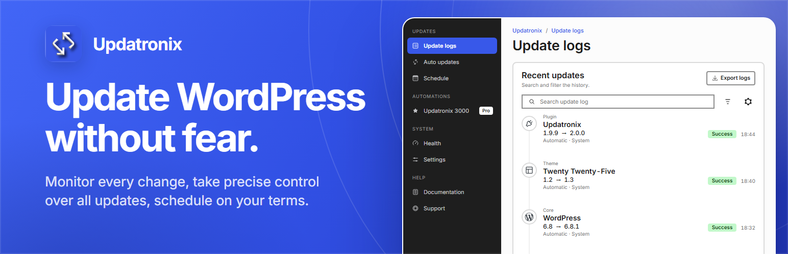

# Updatronix - Update Manager Enhanced



[](https://wordpress.org/plugins/updatronix/)
[](https://wordpress.org/plugins/updatronix/)
[](https://www.php.net/)
[](https://wordpress.org/plugins/updatronix/)
[](https://www.gnu.org/licenses/gpl-2.0.html)
[](https://wordpress.org/plugins/updatronix/)

**Monitor every update and control every automatic update, so you can update your site without the worry.**

WordPress applies your updates but keeps no record of what changed. Updatronix keeps that record and puts the automatic update settings in one place.

It uses WordPress's own update engine. You get a clear history of every update and every automatic update setting on one page, so a failed update is a fact you can check instead of a guess.

### Update without the worry

You do not have to choose between staying updated and staying safe. Updatronix shows you what changed, what is waiting, and what will happen next. When an update goes wrong, the log gives you the exact version, trigger, and error to work from.

**Who it is for:**

- **Solo site owners:** Keep your site up to date and know what changed.
- **Freelancers:** When a client asks what you did, the answer is in the log.
- **Developers:** Control automatic updates and scheduling, with the detail behind every event.
- **Agencies:** Run the same update policy on every client site, each with its own log.

## Table of Contents

- [Features](#features)
- [Updatronix 3000 (Pro)](#updatronix-3000-pro)
- [Compatibility & Multisite](#compatibility--multisite)
- [Installation](#installation)
- [Development](#development)
- [Support & Contribution](#support--contribution)

## Features

### Admin interface

The admin is a dark rail with eleven destinations, one page header per screen, and one manual save. It is built on the WordPress Design System and keeps the native WordPress update engine.

### Update logs

Every core, plugin, theme, and translation update is logged with its before and after versions, what triggered it, and how it ended. The log also records the reason, state, origin, stage, pass, chain, predecessor, next eligible time, and attempt behind each update. Existing rows show "Legacy - reason not recorded" where those fields do not apply.

Filter the log by reason, state, or origin, search it, and export it as a clean report. The Date column is optional; Element and Version are always included.

### Auto updates

Automatic update settings are scattered across several places in WordPress. Updatronix brings them together on one page: core, plugins, themes, and translations. The plugin, theme, and update-core screens also show whether an update installs automatically, or is waiting, held, queued, blocked, or managed.

### Schedule

Choose how often WordPress checks for updates, down to the hour and minute. Pick the time of day, and hold new releases for 0 to 365 days so unstable builds get fixed before they reach you. The screen previews the next run and keeps the saved frequency.

### Health

Health checks show what needs attention before the next update, with a retry action when a check fails.

### Settings

Set how long the log is kept, route WordPress update emails to the right address, or turn them off entirely. Recovery mode emails stay on, so you won't lock yourself out. You can also choose whether uninstall removes your data.

## Updatronix 3000 (Pro)

**Updatronix 3000** is the Pro edition for sites that need the update routine to run itself. It adds the automations on top of the same native engine:

- **Update Shield:** checks every automatic update against your WordPress and PHP versions before it runs, and blocks what does not match.
- **Version Lock:** keeps automatic updates off for VCS checkouts and Composer-managed items, and names the manager.
- **Update Flow:** orders the automatic pass so dependencies run in the right sequence.
- **One automatic pass:** WordPress makes one native call per item and keeps its lock, maintenance mode, and rollback.
- **CSV and JSON exports, White label, and Developer tools.**

Updatronix 3000 requires the free Updatronix plugin.

## Compatibility & Multisite

### Requirements

<!-- harness:compat:start -->
- WordPress **6.2+** (tested up to **7.1**)
- PHP **8.1+**
- Version **2.0.0**
<!-- harness:compat:end -->

### License

GPL-2.0-or-later. See [`LICENSE`](LICENSE).

### Multisite

Updatronix supports multisite networks. Network-activate it once and manage settings, update history, schedule, and email controls from the Network Admin, with one unified update log.

### Privacy

Nothing leaves your site. No analytics, no telemetry, no third-party calls. Updatronix reads from WordPress and writes to your site's storage, and that's the whole network footprint.

### Accessibility

Updatronix aims to be fully accessible to all of its users. If you run into a problem, open a support thread on the plugin page and it'll get fixed.

## Installation

1. Search for "Updatronix" in **Plugins → Add New**, or upload the plugin files to `/wp-content/plugins/updatronix/`.
2. Activate the plugin from the Plugins screen.
3. Open **Tools → Updatronix** (or **Dashboard → Update logs**) to see the history and adjust the settings.

Activation creates the log table and schedules a daily cleanup. Deactivation cancels the cleanup but leaves your data alone. Deletion removes everything. On multisite, network-activate the plugin from the Network Admin; its data lives at the network level.

<!-- harness:start -->
## Development

### Requirements

- PHP **8.1+** · WordPress **6.2+** · Composer · Node.js LTS + npm
- Docker. Every command runs through `bin/harness`, which resolves the backend
  for you — DDEV first, then the host. Nothing needs installing.

### Setup

```bash
composer install
npm install
bin/harness setup   # one-time: dependencies and this project's toolchain
```

### Key commands

| Command | What it does |
|---------|--------------|
| `npm run test:all` | every linter, and the suites the project has |
| `npm run build:all` | `test:all`, then the `.pot`, then the bundle |
| `composer run verify:php` | the pre-push gate: standards and static analysis |
| `composer run verify:all` | the same, plus the integration suite where the project has one |
| `composer run lint:wpcs` / `npm run lint` / `npm run lint:css` | WPCS, ESLint, Stylelint — the `:fix` variants rewrite |
| `composer run lint:pcp` | Plugin Check, where the project ships through WordPress.org |
| `composer run make:pot` | regenerate `languages/updatronix.pot` |
| `npm run zip` | the distributable archive |

**Tests.** This project carries the harness's test layer: `bin/harness test` (unit), `bin/harness integration` (real WordPress, where the project has an integration suite), `bin/harness coverage`, `bin/harness test:js` (Vitest, where `tests/js/` exists), and `bin/harness e2e` (Playwright, where a config exists).

**Anti-tautology.** A test that cannot fail is worse than no test, because it still reports coverage. This is machine-enforced:

- `bin/harness mutation` runs Infection **on the diff only** (`--git-diff-lines`) and fails below **MSI 70**.
- `bin/harness counterfactual` substitutes one token on one changed line, runs the fastest suite that has tests, and reverts -- for the lines Infection cannot reach.
- `bin/check-test-antipatterns.php` runs on every commit. It is a tokenizer scan, not a style opinion, and it **blocks**: `assertTrue(true)` and friends on literals, `markTestSkipped()` with no reason, `expectException()` with no message, and any assertion inside a `try {} catch {}`.

A test that survives a mutation is a finding to fix, not a warning to note.

Assets: `npm start` to watch, `npm run build` for a one-shot bundle.

Anything without a script above goes through the runtime directly:

```bash
bin/harness doctor          # backend, tools, graft, manifest — run this first
bin/harness help            # every command
```

**Never call `php`, `composer`, `node`, `npm` or `wp` directly.** The backend is
resolved per project, and a direct call fails in a way that looks like a broken
project rather than a missing environment.
<!-- harness:end -->

## Support & Contribution

Questions? Open a thread on the [support forum](https://wordpress.org/support/plugin/updatronix/).

If Updatronix helps you, [leave a review](https://wordpress.org/plugins/updatronix/#reviews) and tell your friends. You can also sponsor development through [GitHub Sponsors](https://github.com/sponsors/quentin-ld/dashboard) or [buy the author a coffee](https://buymeacoffee.com/quentinld).

---

*Built with WordPress's own update engine. Nothing leaves your site.*
