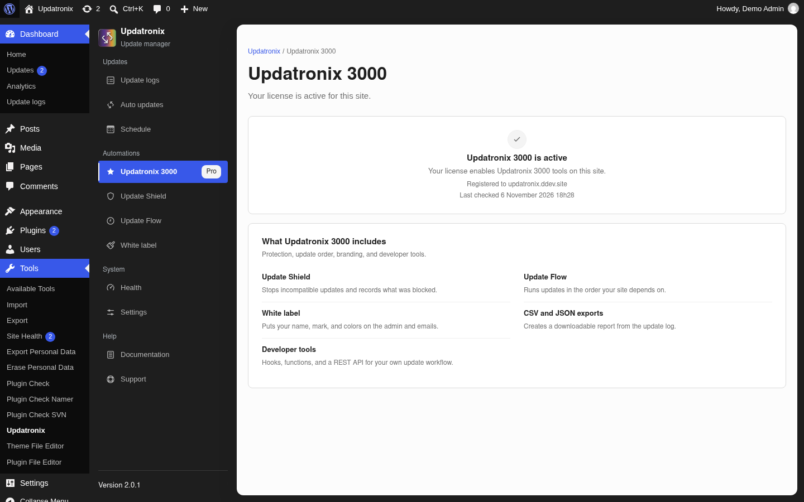
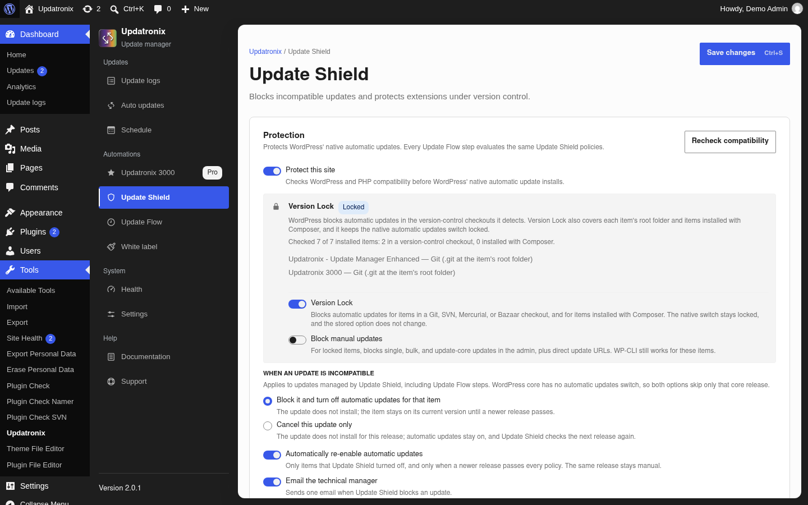
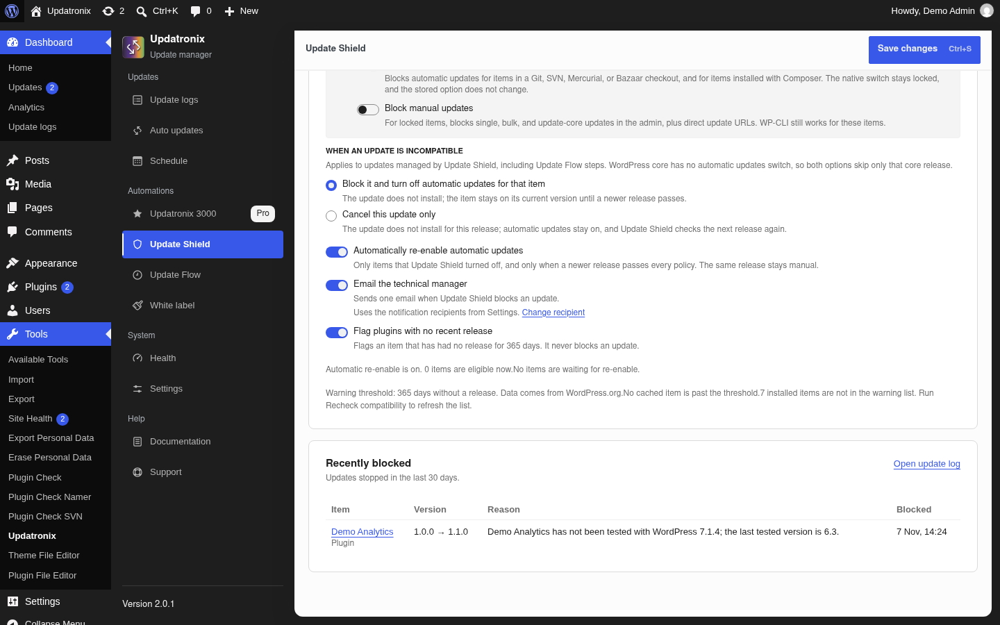
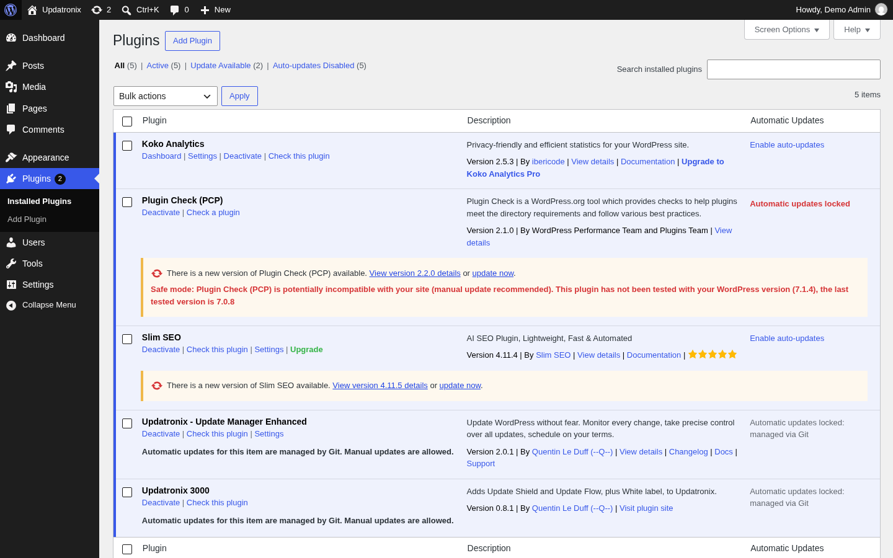
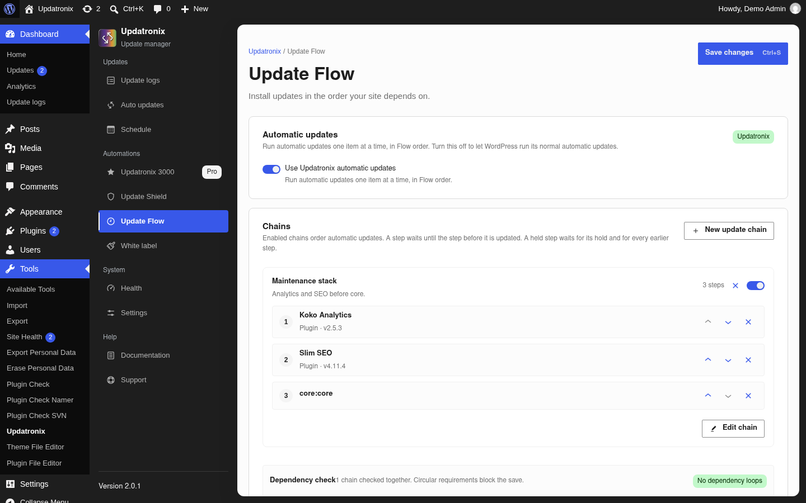
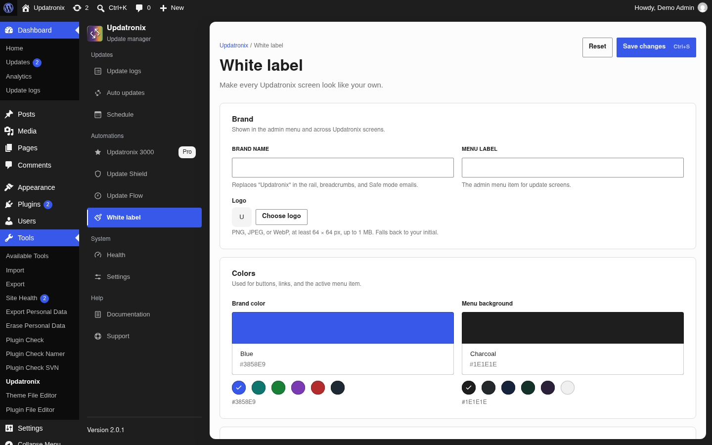
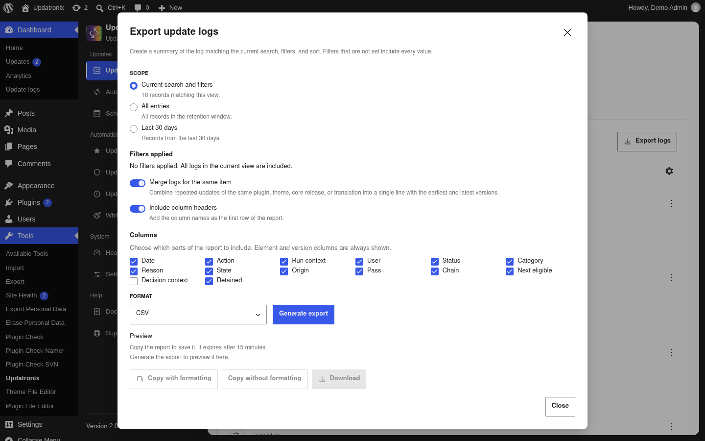

# Updatronix 3000 documentation

[Français](fr.md) · [Documentation index](../README.md) · [Updatronix documentation](../updatronix/en.md)

| Field | Value |
|---|---|
| Version | 0.8.1 |
| Requires Updatronix | 2.0.1 |
| WordPress | 6.2 or later (verified on 7.1.4) |
| PHP | 8.1 or later |
| Last verified | 2026-11-07 |
| Status | verified |

Updatronix 3000 is the Pro edition. It installs on top of Updatronix and adds automation that runs through WordPress's own update engine. The Free edition provides the update log and the automatic update settings; Pro adds the rules, the order, the checks, the branding, and the exports.

This guide quotes the Pro labels as the English Pro screens show them. An installed language pack may localize some messages, so a message can appear in another language on your site.

## What Pro adds

- **Update Shield** blocks an automatic update whose declared WordPress or PHP versions do not match the site. The check also covers version control and Composer management.
- **Safe mode** applies Shield's decisions. It locks the native switches, flags the affected items, writes a log entry, and sends an email.
- **Version Lock** turns off automatic updates for items in a Git, SVN, Mercurial, or Bazaar checkout, and for items managed with Composer.
- **Update Flow** installs updates in the order you set, with dependencies. An item waits for the item it depends on; an independent item continues.
- **One automatic pass** updates one item at a time with WordPress's own engine and ends with one summary row in the log.
- **White label** puts your name, logo, and colors on the screens, the sidebar, and the emails.
- **Structured exports** add CSV, JSON, and XML to the Free plain-text report.
- **Abandoned-plugin advisory** and automatic re-enable when a later release passes every check.
- **Developer tools**: hooks, functions, and a REST API to connect the log to your own tools.

### What Pro does not do

Updatronix 3000 is an automation layer for one site. It does not back up or restore the site, clean files, or manage several sites from one dashboard. Keep a backup and a restore procedure you have tested. For a backup, use a dedicated plugin.

Pro does not replace WordPress's engine: it decides which automatic updates pass, in which order, and it leaves the install, the lock, maintenance mode, and rollback to WordPress.

### One license, one site or one network

One license covers one site or one multisite network. Pro is a network plugin (`Network: true`): on multisite, one license covers the whole network, and the Pro settings live at the network level.

## Requirements

- Updatronix 2.0.1 or later, active. Pro installs on top of the Free plugin; without it, the Pro features do not load.
- Updatronix 3000, version 0.8.1.
- WordPress 6.2 or later.
- PHP 8.1 or later.
- An active Updatronix 3000 license.
- An administrator account. On multisite, a Super Admin account and network activation for both plugins.

The Free edition's requirements, installation, and shared screens are in the [Updatronix documentation](../updatronix/en.md), in particular the [requirements](../updatronix/en.md#requirements).

## Install and activate

### Install Pro on top of Updatronix

1. Install and activate **Updatronix – Update Manager Enhanced**.
2. Upload the `updatronix-pro` folder to `/wp-content/plugins/`, or install the ZIP archive from the vendor.
3. Activate **Updatronix 3000** from **Plugins**.
4. Open **Tools → Updatronix → Updatronix 3000**. On multisite, open **Updatronix** in the **Network Admin**.

The **Updatronix 3000** tab is added by Pro to the Free plugin's screen. It holds the license and the list of Pro features. The three destinations **Update Shield**, **Update Flow**, and **White label** appear in the **Automations** group of the sidebar.

### Without Updatronix, or without a license

Without the Free plugin, the administration shows a notice that starts with **Updatronix 3000 requires the Updatronix plugin. Install Updatronix to enable Updatronix 3000 features.**, with a link to install Updatronix. Until the Free plugin is active, the Pro features do not load.

If the Free plugin is too old, the notice names the minimum version and the installed version: **Updatronix 3000 requires Updatronix %1$s or later. You are running %2$s. Update Updatronix to enable Updatronix 3000 features.** Update Updatronix, then reload the screen.

Without an active license, the Pro destinations show a notice and an **Open Updatronix 3000** button that opens the license tab. The **Updatronix 3000** tab shows the activation form. The Pro screens are not usable until the license is active.

### Multisite

On multisite, activate both plugins for the whole network from the **Network Admin**. The Pro screens are in the **Network Admin**, and only Super Admins reach them. A subsite has no Pro menu or screen.

## License and updates

### Activate a license

1. Open the **Updatronix 3000** tab.
2. In the activation card, enter the key in the **License key** field. The expected format is `UPD-PRO-XXXXXXXX-XXXXXXXX-XXXXXXXX`: the `UPD-PRO-` prefix, then three groups of eight alphanumeric characters.
3. Select **Activate license**. The button shows **Activating** during the request.

The key is sent to the license server with the site domain in normalized form: protocol, trailing slash, and `www.` prefix removed, lowercased. The server compares the declared domain with the site domain.

On success, the card shows **Updatronix 3000 is active** and **Your license enables Updatronix 3000 tools on this site.** It also shows the registered domain under **Registered to**, the last check under **Last checked**, and the masked key when the site stores one.

If the key does not match the format, the field shows **Enter a key in the `UPD-PRO-XXXXXXXX-XXXXXXXX-XXXXXXXX` format.** Attempts are spaced 60 seconds apart; a too-quick retry shows **Wait 60 seconds before you try to activate again.** The server's message appears under the field.

### Check the status

The license is revalidated when WordPress checks for updates. Version 0.8.1 has no separate daily license task: the check follows the site's update schedule, and **Last checked** shows the last pass. The schedule is set in the Free edition's **Schedule** screen; see [Schedule](../updatronix/en.md#schedule).

Three states can interrupt the Pro features:

- **Your saved license is no longer valid**: the service did not confirm this site. Reactivate the key or contact support.
- **The stored license key cannot be decrypted**: the WordPress security keys may have changed. The screen offers **Remove stored license**, then reactivation.
- A network error or an unreadable response does not change the stored status; the next check retries.

### Deactivate a license

Version 0.8.1 does not show a deactivate button in the active state. Removal happens through **Remove stored license** when the screen reports a key it cannot decrypt: the action removes the key from the site and notifies the license server. To release the domain before moving the site, use the deactivation REST route documented in the [developer API](../developer-api/en.md).

### Encrypted storage and domain binding

The key is stored encrypted in the network option `updatronix_pro_license`, with the status, the registered domain, and the last check. Encryption uses AES-256-CBC with a key derived from the WordPress security keys. The plaintext key is never stored: the screen shows only a masked version.

A license binds to the activated domain. A site reachable at both `example.com` and `www.example.com` activates and validates the same way, because the domain is normalized before the comparison. One license covers one site or one network, not a fleet of sites.

### How Pro updates arrive

Pro updates arrive through WordPress's native update system, from the license server:

1. WordPress asks for update data. Pro answers from its cache when the cache is fresh; the cache lasts 12 hours by default.
2. A forced check from **Dashboard → Updates** refreshes the cache.
3. When a version exists, it appears on the updates screen with the package URL supplied by the server. The native process installs it.
4. The license server checks happen only while the license is active.

Pro updates are independent of the Free plugin's updates. If the server announces a version without a package URL, the updates screen shows a warning: the release package is not configured on the license server. Contact support to have it fixed.

### Development mode

`UPDATRONIX_PRO_DEV_MODE` is a developer option, not a step in the normal workflow. Defined in `wp-config.php`, it enables the Pro features on a recognized local environment without a stored key. The domain is checked: the option has no effect on a production site. The screen then shows **Development mode** and **Updatronix 3000 features are enabled for development. No license is stored.**

## Update Shield

Update Shield decides which automatic updates pass before WordPress installs them. It reads the data WordPress downloaded from the WordPress.org API, compares the declared versions with the site's versions, and blocks an incompatible automatic update. It never touches the site's files.

### Settings

The **Update Shield** screen has four parts: **Protection**, **Version Lock**, **When an update is incompatible**, and **Recently blocked**.

- **Protect this site** is the master switch. It is off by default. Its description is **Checks WordPress and PHP compatibility before WordPress' native automatic update installs.**
- **Recheck compatibility** runs the check immediately and refreshes the blocked list.
- **Version Lock** is on by default, but it has no effect while **Protect this site** is off.
- **Block manual updates** is off by default. It blocks manual updates for locked items; WP-CLI keeps working.
- **When an update is incompatible** offers two choices: **Block it and turn off automatic updates for that item** (the default) or **Cancel this update only**. Both choices skip only the affected core release, because core has no automatic update switch.
- **Automatically re-enable automatic updates** is on by default. It applies only to items Shield turned off, and only when a later version passes every check. The same version stays manual.
- **Email the technical manager** is on by default. It sends one email when Update Shield blocks an update. Recipients come from the Free plugin's settings; the **Change recipient** link opens **Settings**.
- **Flag plugins with no recent release** is on by default. It flags an item with no new release for 365 days and never blocks an update.

Two stored settings, `control_wp_version` and `control_php_version`, default to `true` and drive the compatibility policy. The 0.8.1 screen does not expose them as two separate checkboxes: **Protect this site** enables the policy, and **When an update is incompatible** decides the effect.

### What Shield checks

- The WordPress version declared by the update: the tested version for a plugin, or the required version for a theme or core, compared with the site version.
- The PHP version declared by the update, compared with the site version.
- Version control and Composer management: an item in a Git, SVN, Mercurial, or Bazaar checkout, or managed with Composer, enters Version Lock's scope.

The data comes from the update information WordPress downloaded. Between checks, a brand-new incompatible release is detected only after its data reaches the site. **Recheck compatibility** forces a new check.

### What it does not check

Update Shield does not test interactions with other plugins or the theme, it does not analyze your custom code, it does not know your business workflows, and it does not judge the quality of the release itself. An update can pass the checks and introduce a bug. Keep a backup and test important releases.

### Blocked items and recheck

The **Recently blocked** section lists the updates stopped in the last 30 days: the item, the version, the reason, and the date. The **Open update log** link opens the full log.

**Recheck compatibility** clears the update data, calls the WordPress.org API again, and updates the list. Success shows **Compatibility recheck complete.**; failure shows **Compatibility recheck failed. Try again.** If the API is unreachable, the previous list stays.

A blocked item leaves an entry in the Free plugin's log. The actions are `Prevented`, `Incompatible`, and `Disabled` as the case requires; the log remains the single history. See [Update logs](../updatronix/en.md#update-logs).

### Logging and email

Every block, disable, or prevention writes an entry in the Free plugin's log. The email is plain text, with the subject `[%s] Safe mode blocked automatic updates`. The body names the site and the affected items.

The recipient follows the Free plugin's settings. If **Turn off all update emails** is on, no Safe mode email goes out. Otherwise, the email goes to the **Email addresses**, or to the site's administration address when no address is set. WordPress's recovery mode stays active. See [Settings](../updatronix/en.md#settings).

### Abandoned-plugin advisory and automatic re-enable

**Flag plugins with no recent release** flags an item whose last release is more than 365 days old. The threshold is filterable. The advisory never blocks an update: it draws attention. The data comes from WordPress.org; an unknown item is not treated as safe.

**Automatically re-enable automatic updates** turns automatic updates back on for an item Shield cut, but only when a later version passes every check. The same version stays manual. The **Automatic re-enable state** table shows the item, the blocked release, the current update, the state, and the last check. If an installed item is missing from the list, run **Recheck compatibility** to refresh the data.

## Safe mode

Safe mode is Update Shield's enforcement engine. It makes the compatibility decision, prevents the automatic install, turns off the item's native switch, writes to the log, and sends the email. Since 0.8.1, the master switch is **Protect this site**; there is no second **Safe mode** switch on the screen.

### What happens when an update is blocked

For an incompatible item with automatic updates on:

1. The automatic install does not happen. The item stays on its current version.
2. The native automatic update switch is turned off for that item. The write is deferred to the end of the request so the updater is not modified mid-run.
3. A log entry is written.
4. An email goes out if **Email the technical manager** is on and notifications are not suppressed.

The check also runs when a plugin or theme is installed, updated, or activated, and when the theme changes. If an incompatible item becomes active while its automatic update was on, the switch is turned off immediately.

### Native switches locked

The native switches on **Plugins** and **Themes** are locked with **Automatic updates locked by Safe mode: %s**, where `%s` is the reason. The value stored in the native options does not change: the lock comes from a filter. The Free edition's **Auto updates** screen also shows the reason; see [Automatic updates](../updatronix/en.md#automatic-updates).

Version Lock locks items in version control the same way. The **Block manual updates** switch adds a lock on manual updates; it is off by default and WP-CLI stays available.

### Notices on Plugins, Themes, and Updates

- On **Plugins** and **Themes**, a warning line appears under the item: **Safe mode: %1$s is potentially incompatible with your site (manual update recommended).**
- On **Dashboard → Updates**, a notice lists the affected plugins, themes, and core items.
- On **Auto updates**, the locked switch carries the blocking reason.

The notices are informational. They change neither the files nor the installed version.

### Log and email

The log receives Safe mode's messages: **Safe mode detected incompatible %1$s "%2$s": %3$s**, **Safe mode disabled automatic updates for incompatible %1$s "%2$s": %3$s**, and **Safe mode prevented the automatic update of %1$s "%2$s" and disabled automatic updates: %3$s**. Each template receives the item type, the item name, and the reason.

The email is plain text. The subject is `[%s] Safe mode blocked automatic updates`; the body names the site and the items, and closes with **Updatronix 3000 Safe mode sent this email.** The recipient follows the Free plugin's settings. White label can replace the brand in the subject and the body.

Safe mode never blocks a manual update. To install an incompatible item on purpose, run the update from **Dashboard → Updates** or with WP-CLI. The one exception is Version Lock's **Block manual updates** switch, which applies only to locked items and leaves WP-CLI working.

## Version Lock

Version Lock turns off automatic updates for items that live in a version control checkout or are managed with Composer. It protects your working copy: an automatic update would overwrite files tracked by Git or the `composer.lock` file.

### Detection

The detector looks for a marker in the item's root folder:

- `.git` for Git;
- `.svn` for SVN;
- `.hg` for Mercurial;
- `.bzr` for Bazaar.

It also checks Composer management: a `composer.json` with `vendor/composer/installed.json` or `installed.php`, or a Composer project that references the package. The manager name and the evidence are kept for the screen.

### Manager and evidence on the update screen

The **Version Lock** section of **Update Shield** gives the count of inspected items, for example **Checked 7 of 7 installed items: 2 in a version-control checkout, 0 installed with Composer.** It then lists the affected items and the detected manager, for example **Git (.git at the item's root folder)**.

On **Plugins**, the locked item's row carries a notice that names the manager and says manual updates are allowed: **Automatic updates for this item are managed by %s. Manual updates are allowed.** The update screen names the manager and the reason.

### Block manual updates

**Block manual updates** is off by default. When it is on, it blocks single, bulk, and core updates in the administration for locked items, plus direct update URLs. WP-CLI keeps working for those items.

The switch writes the `version_lock_manual_updates` option. Leave it off if you want to update a locked item by hand from the administration.

### The master switch

Version Lock's master switch is **Version Lock** in the **Protection** section of **Update Shield**. It writes `version_control_lock` and defaults to `true`. It has no effect while **Protect this site** is off: the screen then shows **Requires Update Shield. Turn on Protect this site to use Version Lock.** The native stored option does not change; the lock comes from a filter.

## Update Flow

Update Flow gives automatic updates an order. You can declare that one plugin updates before another, or that core updates after a series of plugins. The order applies to the automatic pass; a manual update stays immediate.

### Chains and order

A chain has a name, an optional description, and steps. A step names a plugin, a theme, or core. Steps run from top to bottom; a step waits for the step above it to finish.

The **Update Flow** screen has the **Automatic updates** card, the **Last run** card, and the **Chains** card. **New update chain** opens the editor; **Edit chain** changes an existing chain. The editor offers **Chain name**, **Description**, **Steps run from top to bottom.**, and **Add a step**. **Delete chain** removes the chain after confirmation.

A plan can hold up to 20 chains, and a chain up to 50 steps, within filterable limits. A step must name an installed item.

### Waiting and Blocked states

The pass gives each item a state. The labels are **Done**, **Blocked**, **Waiting**, **Delayed**, **Skipped**, **Failed**, **Needs review**, **Canceled**, **Locked**, **Not managed**, **Not installed**, **Cannot update automatically**, and **Waiting for data**.

- **Waiting**: the item waits for a predecessor that has not finished. The pass picks the item up when the predecessor is done.
- **Blocked**: a predecessor is blocked, locked, failed, uncertain, missing, or not managed. The dependent item stays blocked with the reason.
- An independent item continues: a blocked chain does not stop the others.

The **Last run** card gives the last pass's status, the number of items, the counts, and the reason. It is read-only; a new pass starts at the next update check.

### Chain validation

Saving validates the chain. A chain without a name is refused: **Enter a name for the chain.** A name longer than 120 characters is refused. A step that is not a plugin, a theme, or core is refused. A step that is no longer installed shows **The item %s is no longer installed.**

A dependency loop is refused with **Dependency loop: %s.**; the chain is not saved. Chains share one dependency graph: a loop in one chain blocks the plan.

### Retry

A failed item is retried on the next pass. The pass tries once per item and skips a failed item for the rest of the pass; the second attempt exists only as a guard against a fatal error. The next update check builds a new pass and picks the item up again.

A retry does not apply to an item whose predecessor is blocked: fix the predecessor first, or remove the step from the chain.

## One automatic pass

The automatic pass replaces WordPress's batch install loop with an ordered run, one item at a time. It does not replace WordPress's engine: it chooses the item and lets the native upgrader install it.

### One item at a time

The pass starts at WordPress's update check, in `wp_maybe_auto_update`. It selects an item by Flow order and lets WordPress install it. The other items wait for the next round. The **Automatic updates** card carries the **Use Updatronix automatic updates** switch; the badge shows **Updatronix** when the pass is on and **WordPress** when it is off.

### Lock, maintenance mode, and rollback

The pass uses WordPress's native upgrader. The update lock, maintenance mode, and WordPress's rollback therefore stay in place. The pass does not reimplement the install and does not replace core, plugin, or theme rollback policy.

If the native lock is busy, the pass waits and retries. A stale pass is resumed or abandoned according to its state.

### One summary row in the log

At the end, the pass writes one summary row in the log: items processed, done, failed, uncertain, and status. The summary is also kept in `updatronix_pro_last_pass` for the **Last run** card. That is the row to read to know what the pass actually did.

### The pass switch

The switch writes the `updatronix_pro_update_pass_enabled` option. A filter of the same name turns it off from code. When it is off, WordPress resumes its normal automatic updates; the chains stay saved, but their order is not applied. The screen shows **WordPress is running its normal automatic updates. Your chains are saved, but their order is not applied while this is off.**

If you turn the pass off while it runs, the screen warns: **Stopping after the current item. The remaining items will be canceled.** The pass stops after the current item and cancels the rest.

The switch can be disabled when a constant or a filter decides for you; the reason then appears under the switch.

## White label

White label puts your brand on Updatronix screens and on Safe mode emails. It is opt-in: by default, the fields are empty, the switches are off, and the plugin keeps its name and colors.

### Name, menu label, and logo

- **Brand name** replaces "Updatronix" in the sidebar, breadcrumbs, and Safe mode emails. The field accepts 60 characters.
- **Menu label** replaces the update screens' menu label. The field accepts 40 characters.
- **Logo** opens the media library. The file must be PNG, JPEG, or WebP, at least 64 × 64 px, and at most 1 MB. Without a logo, the brand shows the name's initial. **Remove logo** removes the image.

### Colors, rail, buttons, and links

- **Brand color** colors buttons, links, and the active menu item. The choices are Blue, Teal, Green, Plum, Red, and Ink.
- **Menu background** colors the sidebar. The choices are Charcoal, Slate, Navy, Forest, Plum, and Light.
- **Replace Updatronix branding** replaces the name and mark in the sidebar and the menu.
- **Apply brand to emails** uses the brand name in Safe mode emails. The switch is disabled while **Replace Updatronix branding** is off.
- **Preview** shows the administration menu and a Safe mode email as your users will see them.

### Emails

The Safe mode email uses the brand name in the subject `[%s] Safe mode blocked automatic updates` and in the body. The brand applies only when **Replace Updatronix branding** and **Apply brand to emails** are on. The rest of the email — recipient, item list, reasons — follows the Free plugin's settings.

### Logo constraints

The media picker filters the accepted types. A file of another type shows **Choose a PNG, JPEG, or WebP image.** An image that is too small shows **Choose an image at least 64 × 64 px.** An image that is too heavy shows **Choose an image smaller than 1 MB.** The screen stores the attachment ID, not the file in the settings.

White label requires an active license. Without one, the screen shows **White label requires an active license** and an **Open Updatronix 3000** button.

## Structured exports

The Free edition produces a text report. Pro adds three formats to the same export: CSV, JSON, and XML. The filters, the merge, and the columns do not change.

### Formats

1. Open **Update logs** and apply the filters you want.
2. Select **Export logs**.
3. In the export dialog, choose the scope: **Current search and filters**, **All entries**, or **Last 30 days**.
4. Open the **Format** list. It offers **Plain text**, **CSV**, **JSON**, and **XML** when the Pro license is active.
5. Choose **CSV**, **JSON**, or **XML**, then **Generate export**.
6. Copy the report or download it.

The `updatronix_export_formats` filter adds the three formats when the license is active. Without a license, the list stays on plain text.

### Same filters, merge, and columns

The Pro formats keep the scope, the **Filters applied** header, the **Merge logs for the same item** switch, and the Free export's columns. The report still expires after 15 minutes, and the same rate limits apply. See [Export logs](../updatronix/en.md#export-logs) for the filters, the merge, and the columns.

An export is a report, not a backup: it does not restore the site.

## Multisite

### License and data at the network level

Pro is a network plugin. The license, the Update Shield settings, the Update Flow chains, the pass state, and the white label settings live at the network level. A change applies to every site on the network.

One license covers the network. There is no per-subsite license.

### Super Admin only

The Pro screens and REST routes check `is_super_admin()` on multisite, in addition to the management capability. Only Super Admins open the **Updatronix 3000** tab, **Update Shield**, **Update Flow**, and **White label**.

### What a subsite administrator sees

A subsite administrator sees no Updatronix menu or screen. Pro data is not accessible from the subsite. Management happens in the **Network Admin**. The Free plugin's behavior on a network is described in [Multisite](../updatronix/en.md#multisite).

## Troubleshooting

### The Updatronix 3000 tab is missing

1. Check that **Updatronix – Update Manager Enhanced** is active. Without it, the notice **Updatronix 3000 requires the Updatronix plugin. Install Updatronix to enable Updatronix 3000 features.** appears.
2. Check the Free plugin's version. A notice **Updatronix 3000 requires Updatronix %1$s or later. You are running %2$s. Update Updatronix to enable Updatronix 3000 features.** names the minimum and installed versions.
3. On multisite, check that both plugins are network-activated and that you are in the **Network Admin**.

### The license is not recognized or activation fails

- Check the format: `UPD-PRO-XXXXXXXX-XXXXXXXX-XXXXXXXX`. A bad format shows **Enter a key in the `UPD-PRO-XXXXXXXX-XXXXXXXX-XXXXXXXX` format.**
- After an attempt, wait 60 seconds. A too-quick click shows **Wait 60 seconds before you try to activate again.**
- Check that the site domain is the one the license was issued for. A key already bound to another domain is rejected by the server.
- If the screen shows **Your saved license is no longer valid**, reactivate the key or contact support.
- If the screen shows **The stored license key cannot be decrypted**, the WordPress security keys changed: use **Remove stored license**, then reactivate the key.
- If the license server is unreachable, retry later. The stored status does not change on a network error.

### A Pro update is not offered

1. Check that the license is active: the server checks happen only then.
2. Force a check from **Dashboard → Updates**. The Pro cache lasts 12 hours; a forced check refreshes it.
3. If a version exists but the server returned no package URL, the screen shows a warning. Contact support to configure the package.
4. Remember that Pro updates are independent of the Free plugin's updates.

### Shield blocks an update the site should accept

1. Check that **Protect this site** is on. Without it, the compatibility checks do not apply.
2. Check that the item is actually incompatible and that an automatic update is pending. Shield blocks automatic updates only.
3. Run **Recheck compatibility** to refresh the update data.
4. Update the item by hand: Shield never blocks that path. If **Block manual updates** is on, turn it off for locked items, or use WP-CLI, which stays available.

### Version Lock surprises on a Composer or Git checkout

- The detector found `.git`, `.svn`, `.hg`, `.bzr`, or Composer management in the item's root folder. That is expected: an automatic update would overwrite your working copy.
- Update the item with your version control tool or Composer, then let WordPress see the new version.
- **Block manual updates** is off by default; when it is on, it also blocks manual updates in the administration, but WP-CLI keeps working.
- The master switch is **Version Lock** in **Update Shield**; it needs **Protect this site** to take effect.

### Update Flow stays blocked

1. Open the **Last run** card and read the blocked item's reason.
2. If a predecessor is blocked, locked, or failed, fix it first. A dependent item cannot move before its predecessor.
3. An independent item continues: a blocked chain does not stop the others.
4. The next pass retries the item. If the chain contains a loop or an uninstalled item, fix the chain: validation refuses **Dependency loop: %s.** and **The item %s is no longer installed.**

### White label is not applied

1. Check that **Replace Updatronix branding** is on.
2. For emails, check that **Apply brand to emails** is on; it depends on **Replace Updatronix branding**.
3. Check the logo: PNG, JPEG, or WebP, at least 64 × 64 px, at most 1 MB.
4. Save. The screen reloads the page after saving.
5. Check that the license is active: without one, the screen shows **White label requires an active license**.

## For developers

The hooks, filters, REST routes, classes, and data model of the Pro edition are documented in the [Updatronix developer API](../developer-api/en.md). The Pro routes live under `updatronix-pro/v1`.

The full list, with signatures and `@since`, is in the developer API. The Free plugin's public `updatronix_after_log` action and the external logging API are described in the [Updatronix documentation](../updatronix/en.md#for-developers).
