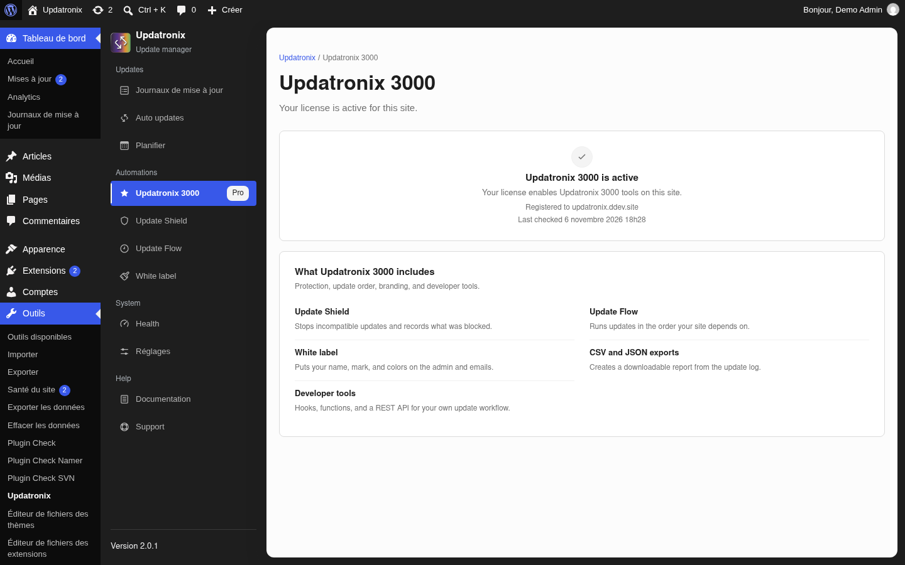
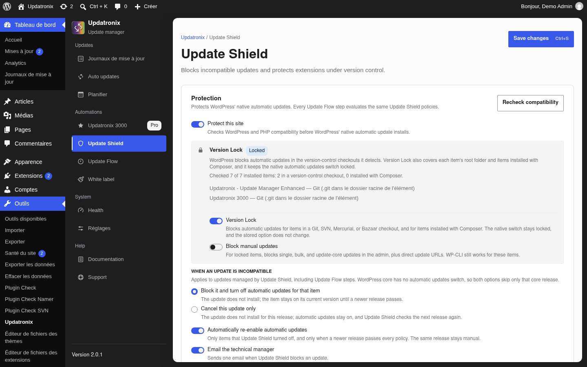
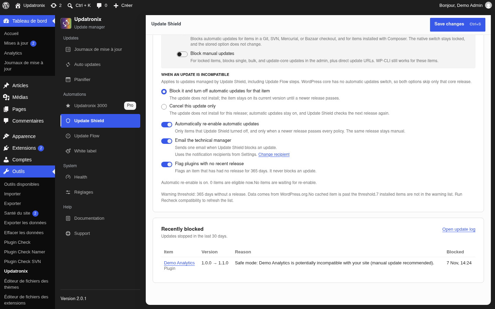
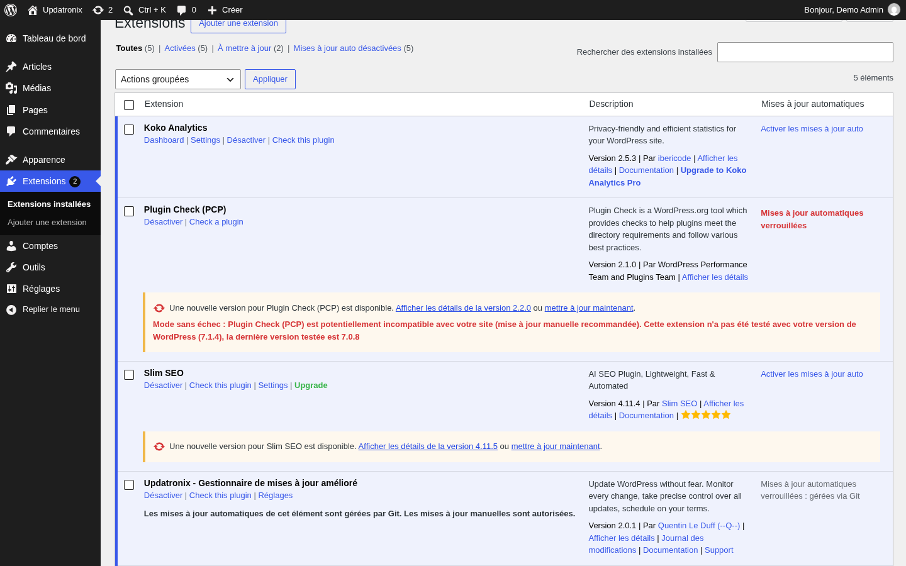
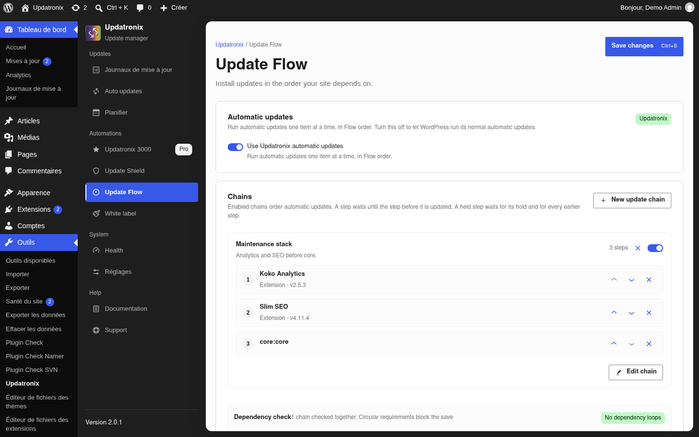
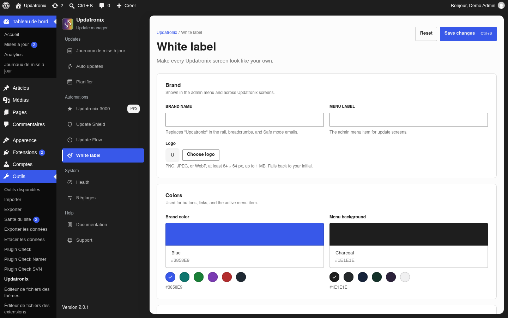
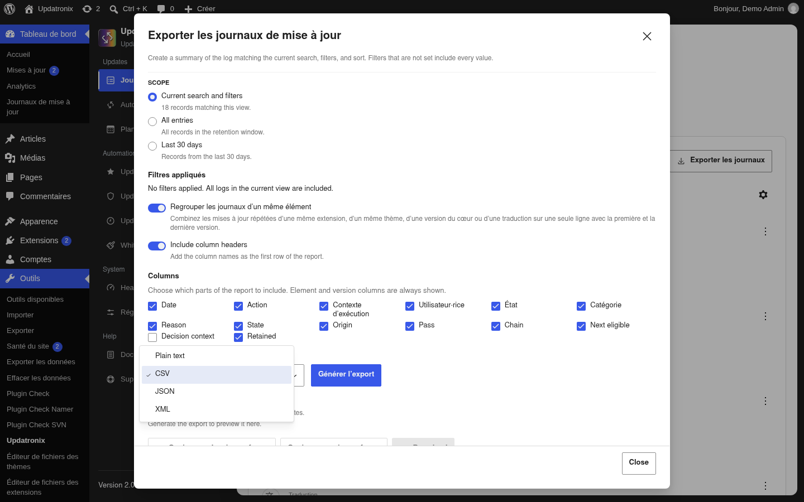

# Documentation Updatronix 3000

[English](en.md) · [Index de la documentation](../README.md) · [Documentation Updatronix](../updatronix/fr.md)

| Champ | Valeur |
|---|---|
| Version | 0.8.1 |
| Updatronix requise | 2.0.1 |
| WordPress | 6.2 ou plus récent (vérifié sur 7.1.4) |
| PHP | 8.1 ou plus récent |
| Dernière vérification | 2026-11-07 |
| Statut | vérifié |

Updatronix 3000 est l'édition Pro. Elle s'installe par-dessus Updatronix et ajoute des automatisations qui passent par le moteur de mise à jour natif de WordPress. L'extension gratuite fournit le journal et les réglages de mise à jour automatique ; l'édition Pro ajoute les règles, l'ordre, les contrôles, la marque et les exports.

Les libellés de l'édition gratuite sont cités en français. Les libellés de l'édition Pro sont cités en anglais, tels qu'ils s'affichent sur les écrans Pro. Le paquet installé peut traduire certains messages Pro ; le guide les cite alors tels qu'ils apparaissent. Aucun libellé français n'est inventé.

## Ce que l'édition Pro apporte

- **Update Shield** : bloque une mise à jour automatique dont les versions WordPress ou PHP déclarées ne correspondent pas au site. Le contrôle couvre aussi la gestion par version control et par Composer.
- **Safe mode** : applique les décisions de Shield. Il verrouille les interrupteurs natifs, signale les éléments concernés, écrit une entrée dans le journal et envoie un e-mail.
- **Version Lock** : coupe les mises à jour automatiques des éléments sous Git, SVN, Mercurial ou Bazaar, et des éléments gérés par Composer.
- **Update Flow** : installe les mises à jour dans l'ordre que vous définissez, avec des dépendances. Un élément attend celui dont il dépend ; un élément indépendant continue.
- **Un seul passage automatique** : WordPress met à jour un élément à la fois avec son propre moteur, et le passage se termine par une ligne de résumé dans le journal.
- **White label** : votre nom, votre logo et vos couleurs sur les écrans, la barre latérale et les e-mails.
- **Exports structurés** : CSV, JSON et XML, en plus du rapport texte de l'édition gratuite.
- **Avis d'extension abandonnée** et réactivation automatique lorsqu'une version suivante passe tous les contrôles.
- **Outils développeur** : hooks, fonctions et API REST pour brancher le journal sur vos propres outils.

### Ce que Pro ne fait pas

Updatronix 3000 est une couche d'automatisation à l'échelle d'un site. Elle ne sauvegarde pas le site, elle ne le restaure pas, elle ne nettoie pas les fichiers, et elle ne pilote pas plusieurs sites depuis un tableau de bord. Gardez une sauvegarde et une procédure de restauration que vous avez testées. Pour une sauvegarde, utilisez une extension dédiée.

L'édition Pro ne remplace pas le moteur de WordPress : elle décide quelles mises à jour automatiques passent, dans quel ordre, et elle laisse l'installation, le verrou, le mode maintenance et le retour en arrière à WordPress.

### Une licence, un site ou un réseau

Une licence couvre un site ou un réseau multisite. L'édition Pro est une extension réseau (`Network: true`) : sur multisite, une seule licence couvre le réseau entier, et les réglages Pro vivent au niveau du réseau.

## Prérequis

- Updatronix 2.0.1 ou plus récent, actif. L'édition Pro s'installe par-dessus l'extension gratuite ; sans elle, les fonctions Pro ne se chargent pas.
- Updatronix 3000, version 0.8.1.
- WordPress 6.2 ou plus récent.
- PHP 8.1 ou plus récent.
- Une licence Updatronix 3000 active.
- Un compte administrateur. Sur multisite, un compte Super administrateur et une activation des deux extensions au niveau du réseau.

Les prérequis de l'édition gratuite, l'installation et les écrans communs sont décrits dans la [documentation Updatronix](../updatronix/fr.md), en particulier les [prérequis](../updatronix/fr.md#prérequis).

## Installer et activer

### Installer Pro par-dessus Updatronix

1. Installez et activez **Updatronix – Update Manager Enhanced**.
2. Téléversez le dossier `updatronix-pro` dans `/wp-content/plugins/`, ou installez l'archive ZIP fournie par l'éditeur.
3. Activez **Updatronix 3000** depuis **Extensions**.
4. Ouvrez **Outils → Updatronix → Updatronix 3000**. Sur multisite, ouvrez **Updatronix** dans l'**Administration du réseau**.

L'onglet **Updatronix 3000** est ajouté par l'édition Pro à l'écran de l'extension gratuite. Il contient la licence et la liste des fonctions Pro. Les trois destinations **Update Shield**, **Update Flow** et **White label** apparaissent dans le groupe **Automations** de la barre latérale.

### Sans Updatronix, ou sans licence

Sans l'extension gratuite, l'administration affiche un avis qui commence par **Updatronix 3000 requires the Updatronix plugin.**, avec un lien pour installer Updatronix. Tant que l'extension gratuite n'est pas active, les fonctions Pro ne se chargent pas.

Si l'extension gratuite est trop ancienne, l'avis annonce la version minimale et la version installée : **Updatronix 3000 requires Updatronix … or later. You are running …**. Mettez Updatronix à jour, puis rechargez l'écran.

Sans licence active, les destinations Pro affichent un avis et un bouton **Open Updatronix 3000** qui renvoie à l'onglet de licence. L'onglet **Updatronix 3000** affiche le formulaire d'activation. Les écrans Pro ne sont pas utilisables tant que la licence n'est pas active.

### Multisite

Sur multisite, activez les deux extensions pour tout le réseau depuis l'**Administration du réseau**. Les écrans Pro se trouvent dans l'**Administration du réseau**, et seuls les Super administrateurs y accèdent. Un sous-site n'a ni menu ni écran Pro.

## Licence et mises à jour

### Activer une licence

1. Ouvrez l'onglet **Updatronix 3000**.
2. Dans la carte d'activation, saisissez la clé dans le champ **License key**. Le format attendu est `UPD-PRO-XXXXXXXX-XXXXXXXX-XXXXXXXX` : le préfixe `UPD-PRO-`, puis trois groupes de huit caractères alphanumériques.
3. Lancez **Activate license**. Le bouton affiche **Activating** pendant la requête.

La clé est envoyée au serveur de licence avec le domaine du site, sous forme normalisée : protocole, barre oblique finale et préfixe `www.` retirés, minuscules. Le serveur compare le domaine déclaré au domaine du site.

En cas de succès, la carte affiche **Updatronix 3000 is active** et la phrase **Your license enables Updatronix 3000 tools on this site.** Elle montre aussi le domaine enregistré sous **Registered to**, la date du dernier contrôle sous **Last checked**, et la clé masquée lorsque le site en stocke une.

Si la clé ne respecte pas le format, le champ affiche **Enter a key in the %s format.** Les tentatives sont espacées de soixante secondes ; un clic trop rapide affiche **Wait %d seconds before you try to activate again.** Le message renvoyé par le serveur s'affiche sous le champ.

### Vérifier le statut

La licence est revalidée lorsque WordPress vérifie les mises à jour. L'édition 0.8.1 n'a pas de tâche quotidienne séparée : le contrôle suit le calendrier de mise à jour du site, et la date **Last checked** indique le dernier passage. Le calendrier se règle dans **Planifier** de l'extension gratuite ; voir [Planification](../updatronix/fr.md#planification).

Trois états peuvent interrompre les fonctions Pro :

- **Your saved license is no longer valid** : le service n'a pas confirmé ce site. Réactivez la clé ou contactez le support.
- **The stored license key cannot be decrypted** : les clés de sécurité de WordPress ont pu changer. L'écran propose **Remove stored license**, puis la réactivation.
- Une erreur réseau ou une réponse illisible ne change pas le statut stocké ; la vérification suivante réessaie.

### Désactiver une licence

La version 0.8.1 n'affiche pas de bouton de désactivation dans l'état actif. Le retrait se fait par **Remove stored license** lorsque l'écran signale une clé indéchiffrable : l'action retire la clé du site et prévient le serveur de licence. Pour libérer le domaine avant de déplacer le site, utilisez la route REST de désactivation documentée dans l'[API développeur](../developer-api/fr.md).

### Stockage chiffré et liaison au domaine

La clé est stockée chiffrée dans l'option réseau `updatronix_pro_license`, avec le statut, le domaine enregistré et la date du dernier contrôle. Le chiffrement utilise AES-256-CBC avec une clé dérivée des clés de sécurité de WordPress. La clé en clair n'est jamais enregistrée : l'écran n'affiche qu'une version masquée.

Une licence se lie au domaine activé. Un site joignable à la fois en `example.com` et en `www.example.com` s'active et se valide de la même façon, parce que le domaine est normalisé avant la comparaison. Une licence couvre un site ou un réseau, pas un parc de sites.

### Comment arrivent les mises à jour Pro

Les mises à jour Pro arrivent par le système natif de WordPress, depuis le serveur de licence :

1. WordPress demande les données de mise à jour. L'édition Pro répond depuis son cache lorsque celui-ci est frais ; le cache dure douze heures par défaut.
2. Une vérification forcée depuis **Tableau de bord → Mises à jour** rafraîchit le cache.
3. Quand une version existe, elle apparaît sur l'écran des mises à jour avec l'URL du paquet fournie par le serveur. Le processus natif s'occupe de l'installation.
4. Les contrôles auprès du serveur de licence n'ont lieu que si la licence est active.

Les mises à jour Pro sont indépendantes de celles de l'extension gratuite. Si le serveur annonce une version sans URL de paquet, l'écran des mises à jour affiche un avertissement : le paquet de cette version n'est pas configuré côté serveur de licence. Contactez le support pour le faire corriger.

### Mode développement

`UPDATRONIX_PRO_DEV_MODE` est une option de développeur, pas une étape du fonctionnement normal. Définie dans `wp-config.php`, elle active les fonctions Pro sur un environnement local reconnu, sans clé stockée. Le domaine est vérifié : l'option n'a aucun effet sur un site de production. L'écran affiche alors **Development mode** et **Updatronix 3000 features are enabled for development. No license is stored.**

## Update Shield

Update Shield décide quelles mises à jour automatiques passent avant que WordPress ne les installe. Il lit les données que WordPress a téléchargées depuis l'API WordPress.org, compare les versions déclarées aux versions du site, et bloque une mise à jour automatique incompatible. Il ne touche jamais aux fichiers du site.

### Les réglages

L'écran **Update Shield** est organisé en quatre blocs : **Protection**, **Version Lock**, **When an update is incompatible** et **Recently blocked**.

- **Protect this site** est l'interrupteur principal. Il est désactivé par défaut. Sa description : **Checks WordPress and PHP compatibility before WordPress' native automatic update installs.**
- **Recheck compatibility** relance immédiatement le contrôle et rafraîchit la liste des éléments bloqués.
- **Version Lock** est activé par défaut, mais il reste sans effet tant que **Protect this site** est désactivé.
- **Block manual updates** est désactivé par défaut. Il bloque les mises à jour manuelles des éléments verrouillés ; WP-CLI continue de fonctionner.
- **When an update is incompatible** propose deux choix : **Block it and turn off automatic updates for that item** (le choix par défaut) ou **Cancel this update only**. Les deux choix ne sautent que la version du cœur concernée, parce que le cœur n'a pas d'interrupteur de mise à jour automatique.
- **Automatically re-enable automatic updates** est activé par défaut. Il ne concerne que les éléments que Shield a coupés, et seulement quand une version plus récente passe tous les contrôles. La même version reste manuelle.
- **Email the technical manager** est activé par défaut. Il envoie un e-mail lorsqu'Update Shield bloque une mise à jour. Les destinataires viennent des réglages de l'extension gratuite ; le lien **Change recipient** ouvre **Réglages**.
- **Flag plugins with no recent release** est activé par défaut. Il signale un élément sans nouvelle version depuis 365 jours et ne bloque jamais une mise à jour.

Deux réglages stockés, `control_wp_version` et `control_php_version`, valent `true` par défaut et alimentent la politique de compatibilité. L'écran 0.8.1 ne les expose pas comme deux cases séparées : **Protect this site** active la politique, et **When an update is incompatible** décide de l'effet.

### Ce que Shield contrôle

- La version de WordPress déclarée par la mise à jour : la version testée pour une extension, ou la version exigée pour un thème ou le cœur, comparée à la version du site.
- La version de PHP déclarée par la mise à jour, comparée à la version du site.
- La gestion par version control et par Composer : un élément sous Git, SVN, Mercurial ou Bazaar, ou géré par Composer, entre dans le périmètre de Version Lock.

Les données viennent des informations de mise à jour que WordPress a téléchargées. Entre deux vérifications, une version incompatible toute fraîche n'est détectée qu'une fois ses données arrivées sur le site. **Recheck compatibility** force un nouveau contrôle.

### Ce qu'il ne contrôle pas

Update Shield ne teste pas les interactions avec les autres extensions ou le thème, il n'analyse pas votre code personnalisé, il ne connaît pas vos processus métier, et il ne juge pas la qualité de la version elle-même. Une mise à jour peut passer les contrôles et introduire un bug. Gardez une sauvegarde et testez les versions importantes.

### Éléments bloqués et nouvelle vérification

La section **Recently blocked** liste les mises à jour arrêtées dans les trente derniers jours : l'élément, la version, la raison et la date. Le lien **Open update log** ouvre le journal complet.

**Recheck compatibility** vide les données de mise à jour, interroge à nouveau l'API WordPress.org et met la liste à jour. Un succès affiche **Compatibility recheck complete.** ; un échec affiche **Compatibility recheck failed. Try again.** Si l'API est injoignable, la liste précédente reste en place.

Un élément bloqué laisse une entrée dans le journal de l'extension gratuite. Les actions sont `Prevented`, `Incompatible` et `Disabled` selon le cas ; le journal reste l'historique unique. Voir [Journal des mises à jour](../updatronix/fr.md#journal-des-mises-à-jour).

### Journalisation et e-mail

Chaque blocage, désactivation ou prévention écrit une entrée dans le journal de l'extension gratuite. L'e-mail part en texte brut, avec l'objet `[%s] Safe mode blocked automatic updates`. Le corps nomme le site et les éléments concernés.

Le destinataire suit les réglages de l'extension gratuite. Si **Turn off all update emails** est actif, aucun e-mail de Safe mode ne part. Sinon, l'e-mail va aux adresses de **Email addresses**, ou à l'adresse d'administration du site lorsqu'aucune adresse n'est renseignée. Le mode de récupération de WordPress reste actif. Voir [Réglages](../updatronix/fr.md#réglages).

### Avis d'extension abandonnée et réactivation automatique

**Flag plugins with no recent release** signale un élément dont la dernière version date de plus de 365 jours. Le seuil est filtrable. L'avis ne bloque jamais une mise à jour : il attire l'attention. Les données viennent de WordPress.org ; un élément inconnu n'est pas traité comme sûr.

**Automatically re-enable automatic updates** remet la mise à jour automatique sur un élément que Shield avait coupé, mais seulement quand une version plus récente passe tous les contrôles. La même version reste manuelle. Le tableau **Automatic re-enable state** montre l'élément, la version bloquée, la version courante, l'état et la dernière vérification. Si un élément installé n'apparaît pas dans la liste, lancez **Recheck compatibility** pour rafraîchir les données.

## Safe mode

Safe mode est le moteur d'application d'Update Shield. Il prend la décision de compatibilité, empêche l'installation automatique, coupe l'interrupteur natif de l'élément, écrit dans le journal et envoie l'e-mail. Depuis 0.8.1, l'interrupteur principal s'appelle **Protect this site** ; il n'y a pas de second interrupteur **Safe mode** sur l'écran.

### Ce qui se passe quand une mise à jour est bloquée

Pour un élément incompatible dont la mise à jour automatique est active :

1. L'installation automatique n'a pas lieu. L'élément reste sur sa version actuelle.
2. L'interrupteur natif de mise à jour automatique est coupé pour cet élément. L'écriture est différée à la fin de la requête pour ne pas modifier le moteur en pleine exécution.
3. Une entrée est écrite dans le journal.
4. Un e-mail part si **Email the technical manager** est actif et si les notifications ne sont pas coupées.

Le contrôle tourne aussi à l'installation, à la mise à jour ou à l'activation d'une extension ou d'un thème, et au changement de thème. Si un élément incompatible devient actif alors que sa mise à jour automatique était active, l'interrupteur est coupé immédiatement.

### Les interrupteurs natifs verrouillés

Les interrupteurs natifs des écrans **Extensions** et **Thèmes** sont verrouillés avec la mention **Automatic updates locked by Safe mode: %s**, où `%s` est la raison. Le réglage stocké dans les options natives ne change pas : le verrou est appliqué par un filtre. L'écran **Mises à jour automatiques** de l'extension gratuite affiche aussi la raison ; voir [Mises à jour automatiques](../updatronix/fr.md#mises-à-jour-automatiques).

Version Lock verrouille de la même façon les éléments sous version control. L'interrupteur **Block manual updates** ajoute un verrou sur les mises à jour manuelles ; il est désactivé par défaut et WP-CLI reste disponible.

### Les avis sur Extensions, Thèmes et Mises à jour

- Sur **Extensions** et **Thèmes**, une ligne d'avertissement apparaît sous l'élément : **Safe mode: %1$s is potentially incompatible with your site (manual update recommended).**
- Sur **Tableau de bord → Mises à jour**, un avis liste les extensions, les thèmes et les éléments du cœur concernés.
- Sur **Mises à jour automatiques**, l'interrupteur verrouillé porte la raison du blocage.

Les avis sont informatifs. Ils ne modifient ni les fichiers ni la version installée.

### Journal et e-mail

Le journal reçoit les messages de Safe mode : **Safe mode: %1$s is potentially incompatible with your site (manual update recommended).**, **Safe mode disabled automatic updates for incompatible %1$s "%2$s": %3$s** et **Safe mode prevented the automatic update of %1$s "%2$s" and disabled automatic updates: %3$s**. Le premier message reçoit le type d'élément, son nom et la raison.

L'e-mail part en texte brut. L'objet est `[%s] Safe mode blocked automatic updates` ; le corps nomme le site et les éléments, et se termine par **Updatronix 3000 Safe mode sent this email.** Le destinataire suit les réglages de l'extension gratuite. Le white label peut remplacer le nom de marque dans l'objet et le corps.

Safe mode ne bloque jamais une mise à jour manuelle. Pour installer volontairement un élément incompatible, lancez la mise à jour depuis **Tableau de bord → Mises à jour** ou avec WP-CLI. La seule exception est l'interrupteur **Block manual updates** de Version Lock, qui ne s'applique qu'aux éléments verrouillés et laisse WP-CLI travailler.

## Version Lock

Version Lock coupe les mises à jour automatiques des éléments qui vivent dans un checkout de version control ou qui sont gérés par Composer. Il protège votre copie de travail : une mise à jour automatique écraserait les fichiers suivis par Git ou le fichier `composer.lock`.

### La détection

Le détecteur cherche un marqueur dans le dossier racine de l'élément :

- `.git` pour Git ;
- `.svn` pour SVN ;
- `.hg` pour Mercurial ;
- `.bzr` pour Bazaar.

Il vérifie aussi la gestion par Composer : un `composer.json` avec `vendor/composer/installed.json` ou `installed.php`, ou un projet Composer qui référence le paquet. Le nom du gestionnaire et la preuve sont conservés pour l'écran.

### Le gestionnaire et la preuve affichés

La section **Version Lock** de l'écran **Update Shield** donne le compte des éléments inspectés, par exemple **Checked 7 of 7 installed items: 2 in a version-control checkout, 0 installed with Composer.** Elle liste ensuite les éléments concernés et le gestionnaire détecté, par exemple **Git (.git dans le dossier racine de l'élément)**.

Sur l'écran **Extensions**, la ligne de l'élément verrouillé porte un avis qui nomme le gestionnaire et rappelle que les mises à jour manuelles restent autorisées. L'écran des mises à jour nomme le gestionnaire et la raison.

### Bloquer les mises à jour manuelles

**Block manual updates** est désactivé par défaut. Activé, il bloque, pour les éléments verrouillés, les mises à jour simples, groupées et du cœur dans l'administration, ainsi que les URL de mise à jour directes. WP-CLI continue de fonctionner pour ces éléments.

L'interrupteur écrit l'option `version_lock_manual_updates`. Laissez-le désactivé si vous voulez pouvoir mettre à jour un élément verrouillé à la main depuis l'administration.

### L'interrupteur principal

Le maître de Version Lock est l'interrupteur **Version Lock** de la section **Protection**, dans **Update Shield**. Il écrit `version_control_lock` et vaut `true` par défaut. Il reste sans effet tant que **Protect this site** est désactivé : l'écran affiche alors **Requires Update Shield. Turn on Protect this site to use Version Lock.** Le réglage natif stocké ne change pas ; le verrou est appliqué par un filtre.

## Update Flow

Update Flow donne un ordre aux mises à jour automatiques. Vous pouvez déclarer qu'une extension doit être mise à jour avant une autre, ou que le cœur passe après une série d'extensions. L'ordre s'applique au passage automatique ; une mise à jour manuelle reste immédiate.

### Les chaînes et l'ordre

Une chaîne porte un nom, une description facultative et des étapes. Une étape désigne une extension, un thème ou le cœur. Les étapes s'exécutent de haut en bas ; une étape attend que celle du dessus soit terminée.

L'écran **Update Flow** contient la carte **Automatic updates**, la carte **Last run** et la carte **Chains**. **New update chain** ouvre l'éditeur ; **Edit chain** modifie une chaîne existante. L'éditeur propose **Chain name**, **Description**, **Steps run from top to bottom.** et **Add a step**. **Delete chain** supprime la chaîne après confirmation.

Le plan peut contenir jusqu'à 20 chaînes, et une chaîne jusqu'à 50 étapes, dans les limites filtrables. Une étape doit désigner un élément installé.

### Les états Waiting et Blocked

Le passage donne à chaque élément un état. Les libellés sont **Done**, **Blocked**, **Waiting**, **Delayed**, **Skipped**, **Failed**, **Needs review**, **Canceled**, **Locked**, **Not managed**, **Not installed**, **Cannot update automatically** et **Waiting for data**.

- **Waiting** : l'élément attend un prédécesseur qui n'a pas encore terminé. Le passage reprend l'élément quand le prédécesseur est fait.
- **Blocked** : un prédécesseur est bloqué, verrouillé, en échec, incertain, introuvable ou non géré. L'élément dépendant reste bloqué avec la raison.
- Un élément indépendant continue : le blocage d'une chaîne n'arrête pas les autres.

La carte **Last run** donne le statut du dernier passage, le nombre d'éléments, les comptes et la raison. Elle est en lecture seule ; un nouveau passage part à la vérification de mise à jour suivante.

### La validation des chaînes

L'enregistrement valide la chaîne. Une chaîne sans nom est refusée : **Give every chain a name.** Un nom de plus de 120 caractères est refusé. Une étape qui n'est pas une extension, un thème ou le cœur est refusée. Une étape qui n'est plus installée affiche **The item %s is no longer installed.**

Une boucle de dépendances est refusée avec **Dependency loop: %s** ; la chaîne n'est pas enregistrée. Les chaînes partagent un même graphe de dépendances : une boucle dans une chaîne bloque le plan.

### Une nouvelle tentative

Un élément en échec est retenté au passage suivant. Le passage tente une fois par élément et saute un élément en échec pour le reste du passage ; la seconde tentative n'existe que comme garde-fou contre une erreur fatale. Le prochain contrôle de mise à jour construit un nouveau passage et reprend l'élément.

Une nouvelle tentative ne s'applique pas à un élément dont le prédécesseur est bloqué : corrigez d'abord le prédécesseur, ou retirez l'étape de la chaîne.

## Un seul passage automatique

Le passage automatique remplace la boucle d'installation en lot de WordPress par une exécution ordonnée, un élément à la fois. Il ne remplace pas le moteur de WordPress : il choisit l'élément et laisse l'upgrader natif faire l'installation.

### Un élément à la fois

Le passage part à la vérification de mise à jour de WordPress, dans `wp_maybe_auto_update`. Il sélectionne un élément selon l'ordre de Flow et laisse WordPress l'installer. Les autres éléments attendent le prochain tour. La carte **Automatic updates** porte l'interrupteur **Use Updatronix automatic updates** ; le badge affiche **Updatronix** quand le passage est actif, **WordPress** quand il est coupé.

### Verrou, mode maintenance et retour en arrière

Le passage utilise l'upgrader natif de WordPress. Le verrou de mise à jour, le mode maintenance et le retour en arrière de WordPress restent donc en place. Le passage ne réimplémente pas l'installation et ne remplace pas la politique de retour en arrière du cœur, des extensions ou des thèmes.

Si le verrou natif est occupé, le passage attend et réessaie. Un passage périmé est repris ou abandonné selon son état.

### Une ligne de résumé dans le journal

À la fin, le passage écrit une ligne de résumé dans le journal : éléments traités, faits, échoués, incertains et statut. Le résumé est aussi conservé dans `updatronix_pro_last_pass` pour la carte **Last run**. C'est la ligne à lire pour savoir ce que le passage a réellement fait.

### L'interrupteur du passage

L'interrupteur écrit l'option `updatronix_pro_update_pass_enabled`. Le filtre du même nom le coupe depuis le code. Coupé, WordPress reprend ses mises à jour automatiques normales ; les chaînes restent enregistrées, mais leur ordre n'est pas appliqué. L'écran affiche **WordPress is running its normal automatic updates. Your chains are saved, but their order is not applied while this is off.**

Si vous coupez le passage pendant qu'il tourne, l'écran prévient : **Stopping after the current item. The remaining items will be canceled.** Le passage s'arrête après l'élément courant et annule le reste.

L'interrupteur peut être désactivé lorsqu'une constante ou un filtre décide à votre place ; la raison s'affiche alors sous l'interrupteur.

## White label

White label met votre marque sur les écrans Updatronix et sur les e-mails de Safe mode. C'est une option : par défaut, les champs sont vides, les interrupteurs sont éteints, et l'extension garde son nom et ses couleurs.

### Nom, libellé du menu, logo

- **Brand name** remplace « Updatronix » dans la barre latérale, les fils d'Ariane et les e-mails de Safe mode. Le champ accepte 60 caractères.
- **Menu label** remplace le libellé du menu des écrans de mise à jour. Le champ accepte 40 caractères.
- **Logo** ouvre la médiathèque. Le fichier doit être PNG, JPEG ou WebP, faire au moins 64 × 64 px et au plus 1 Mo. Sans logo, la marque affiche l'initiale du nom. **Remove logo** retire l'image.

### Couleurs, rail, boutons et liens

- **Brand color** colore les boutons, les liens et l'élément actif du menu. Les choix proposés sont Blue, Teal, Green, Plum, Red et Ink.
- **Menu background** colore la barre latérale. Les choix sont Charcoal, Slate, Navy, Forest, Plum et Light.
- **Replace Updatronix branding** remplace le nom et la marque dans la barre latérale et le menu.
- **Apply brand to emails** utilise le nom de marque dans les e-mails de Safe mode. L'interrupteur est désactivé tant que **Replace Updatronix branding** est éteint.
- **Preview** montre le menu d'administration et un e-mail de Safe mode tels que vos utilisateurs les verront.

### E-mails

L'e-mail de Safe mode utilise le nom de marque dans l'objet `[%s] Safe mode blocked automatic updates` et dans le corps. La marque ne s'applique que si **Replace Updatronix branding** et **Apply brand to emails** sont activés. Le reste de l'e-mail — destinataire, liste des éléments, raisons — suit les réglages de l'extension gratuite.

### Contraintes du logo

Le sélecteur de médias filtre les types acceptés. Un fichier d'un autre type affiche **Choose a PNG, JPEG, or WebP image.** Une image trop petite affiche **Choose an image at least 64 × 64 px.** Une image trop lourde affiche **Choose an image smaller than 1 MB.** L'écran enregistre l'identifiant de la pièce jointe, pas le fichier dans les réglages.

Le white label demande une licence active. Sans licence, l'écran affiche **White label requires an active license** et un bouton **Open Updatronix 3000**.

## Exports structurés

L'édition gratuite produit un rapport texte. L'édition Pro ajoute trois formats au même export : CSV, JSON et XML. Les filtres, le regroupement et les colonnes ne changent pas.

### Les formats

1. Ouvrez **Journaux de mise à jour** et appliquez les filtres voulus.
2. Cliquez sur **Exporter les journaux**.
3. Dans la fenêtre d'export, choisissez la portée : **Current search and filters**, **All entries** ou **Last 30 days**.
4. Ouvrez la liste **Format**. Elle propose **Plain text**, **CSV**, **JSON** et **XML** lorsque la licence Pro est active.
5. Choisissez **CSV**, **JSON** ou **XML**, puis **Générer l'export**.
6. Copiez le rapport ou téléchargez-le.

Le filtre `updatronix_export_formats` ajoute les trois formats quand la licence est active. Sans licence, la liste reste au texte brut.

### Les mêmes filtres, regroupement et colonnes

Les formats Pro reprennent la portée, l'en-tête **Filtres appliqués**, l'interrupteur **Merge logs for the same item** et les colonnes de l'export gratuit. Le rapport expire toujours après quinze minutes, et les mêmes limites de débit s'appliquent. Voir [Exporter les journaux](../updatronix/fr.md#exporter-les-journaux) pour le détail des filtres, du regroupement et des colonnes.

Un export est un rapport, pas une sauvegarde : il ne restaure pas le site.

## Multisite

### Licence et données au niveau du réseau

L'édition Pro est une extension réseau. La licence, les réglages d'Update Shield, les chaînes d'Update Flow, l'état du passage et les réglages de white label vivent au niveau du réseau. Une modification s'applique à tous les sites du réseau.

Une licence couvre le réseau. Il n'y a pas de licence par sous-site.

### Super administrateur uniquement

Les écrans Pro et les routes REST vérifient `is_super_admin()` sur multisite, en plus de la capacité de gestion. Seuls les Super administrateurs ouvrent l'onglet **Updatronix 3000**, **Update Shield**, **Update Flow** et **White label**.

### Ce que voit un administrateur de sous-site

Un administrateur de sous-site ne voit ni menu ni écran Updatronix. Les données Pro ne sont pas accessibles depuis le sous-site. La gestion se fait dans l'**Administration du réseau**. Le fonctionnement de l'extension gratuite sur un réseau est décrit dans [Multisite](../updatronix/fr.md#multisite).

## Résolution des problèmes

### L'onglet Updatronix 3000 est absent

1. Vérifiez que **Updatronix – Update Manager Enhanced** est actif. Sans lui, l'avis **Updatronix 3000 requires the Updatronix plugin.** apparaît.
2. Vérifiez la version de l'extension gratuite. Un avis **Updatronix 3000 requires Updatronix … or later** indique la version minimale et la version installée.
3. Sur multisite, vérifiez que les deux extensions sont activées pour le réseau et que vous êtes dans l'**Administration du réseau**.

### La licence n'est pas reconnue ou l'activation échoue

- Vérifiez le format : `UPD-PRO-XXXXXXXX-XXXXXXXX-XXXXXXXX`. Un format incorrect affiche **Enter a key in the %s format.**
- Après une tentative, attendez soixante secondes. Un clic trop rapide affiche **Wait %d seconds before you try to activate again.**
- Vérifiez que le domaine du site est bien celui de la licence. Une clé déjà liée à un autre domaine est refusée par le serveur.
- Si l'écran affiche **Your saved license is no longer valid**, réactivez la clé ou contactez le support.
- Si l'écran affiche **The stored license key cannot be decrypted**, les clés de sécurité de WordPress ont changé : utilisez **Remove stored license**, puis réactivez la clé.
- Si le serveur de licence est injoignable, réessayez plus tard. Le statut stocké ne change pas sur une erreur réseau.

### Une mise à jour Pro n'est pas proposée

1. Vérifiez que la licence est active : les contrôles auprès du serveur n'ont lieu que dans ce cas.
2. Forcez une vérification depuis **Tableau de bord → Mises à jour**. Le cache Pro dure douze heures ; une vérification forcée le rafraîchit.
3. Si une version existe mais que le serveur n'a pas renvoyé d'URL de paquet, l'écran affiche un avertissement. Contactez le support pour faire configurer le paquet.
4. Rappelez-vous que les mises à jour Pro sont indépendantes de celles de l'extension gratuite.

### Shield bloque une mise à jour que le site devrait accepter

1. Vérifiez que **Protect this site** est actif. Sans lui, les contrôles de compatibilité ne s'appliquent pas.
2. Vérifiez que l'élément est réellement incompatible et qu'une mise à jour automatique est en attente. Shield ne bloque que les mises à jour automatiques.
3. Lancez **Recheck compatibility** pour rafraîchir les données de mise à jour.
4. Mettez l'élément à jour à la main : Shield ne bloque jamais ce chemin. Si **Block manual updates** est actif, désactivez-le pour les éléments verrouillés, ou utilisez WP-CLI, qui reste autorisé.

### Version Lock surprend sur un checkout Composer ou Git

- Le détecteur a trouvé `.git`, `.svn`, `.hg`, `.bzr` ou une gestion Composer dans le dossier racine de l'élément. C'est le comportement attendu : une mise à jour automatique écraserait votre copie de travail.
- Mettez l'élément à jour avec votre outil de version control ou Composer, puis laissez WordPress voir la nouvelle version.
- **Block manual updates** est désactivé par défaut ; s'il est actif, il bloque aussi les mises à jour manuelles dans l'administration, mais WP-CLI continue de fonctionner.
- L'interrupteur principal est **Version Lock** dans **Update Shield** ; il faut **Protect this site** pour l'activer.

### Update Flow reste bloqué

1. Ouvrez la carte **Last run** et lisez la raison de l'élément bloqué.
2. Si un prédécesseur est bloqué, verrouillé ou en échec, corrigez-le d'abord. Un élément dépendant ne peut pas avancer avant son prédécesseur.
3. Un élément indépendant continue : le blocage d'une chaîne n'arrête pas les autres.
4. Le prochain passage retente l'élément. Si la chaîne contient une boucle ou un élément désinstallé, corrigez la chaîne : la validation refuse **Dependency loop: %s** et **The item %s is no longer installed.**

### Le white label n'est pas appliqué

1. Vérifiez que **Replace Updatronix branding** est actif.
2. Pour les e-mails, vérifiez que **Apply brand to emails** est actif ; il dépend de **Replace Updatronix branding**.
3. Vérifiez le logo : PNG, JPEG ou WebP, au moins 64 × 64 px, au plus 1 Mo.
4. Enregistrez. L'écran recharge la page après l'enregistrement.
5. Vérifiez que la licence est active : sans licence, l'écran affiche **White label requires an active license**.

## Développeurs

Les hooks, filtres, routes REST, classes et le modèle de données de l'édition Pro sont documentés dans l'[API développeur Updatronix](../developer-api/fr.md). Les routes Pro vivent sous `updatronix-pro/v1`.

La liste complète, avec les signatures et les `@since`, est dans l'API développeur. L'action publique de l'extension gratuite `updatronix_after_log` et l'API de journalisation externe sont décrites dans la [documentation Updatronix](../updatronix/fr.md#développeurs).
