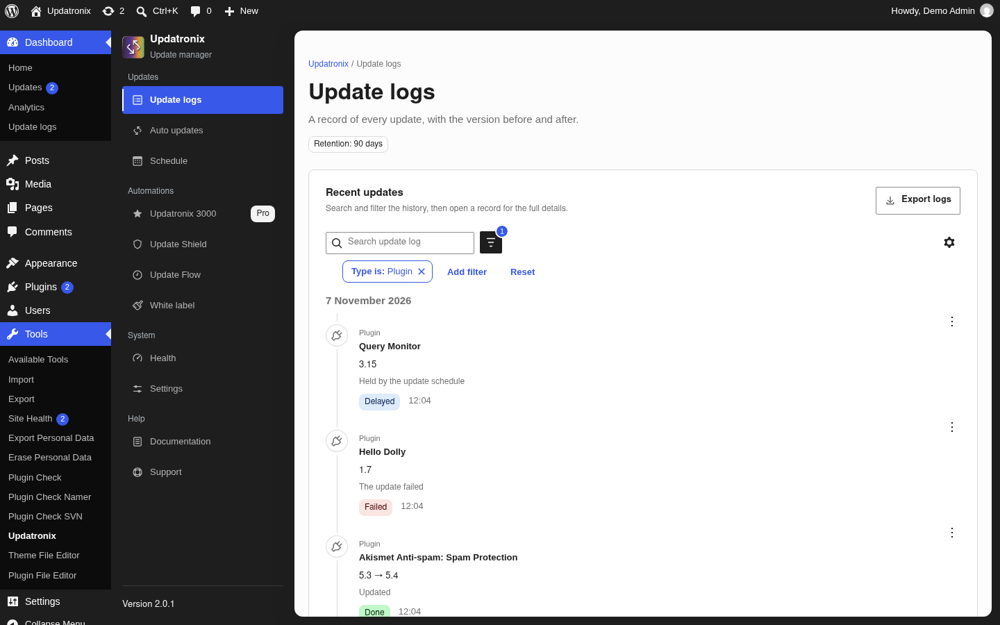
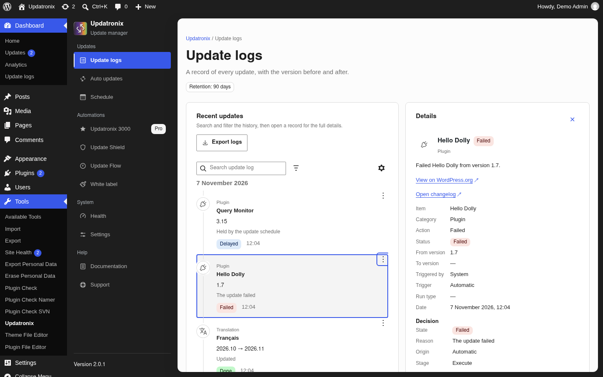
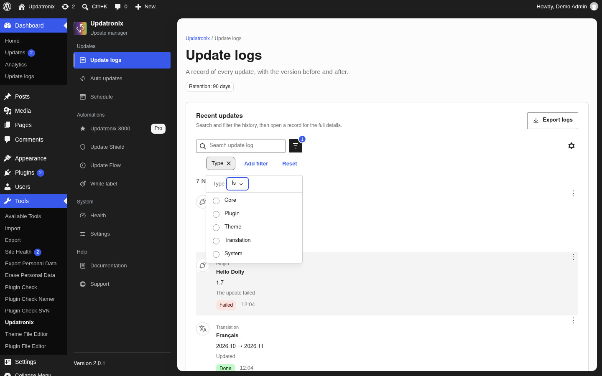
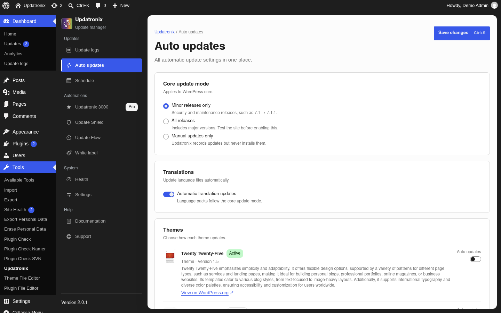
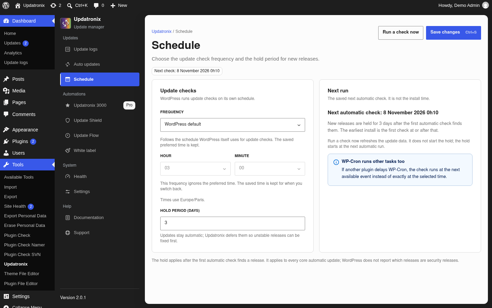
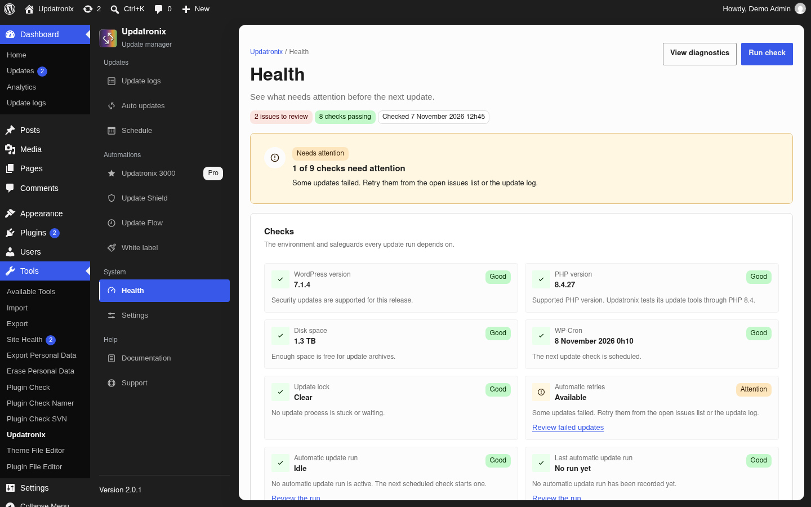
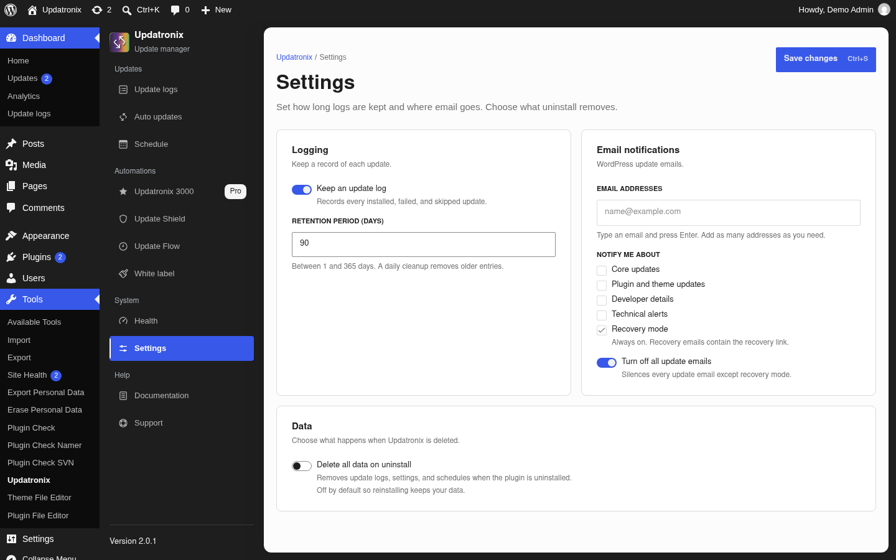
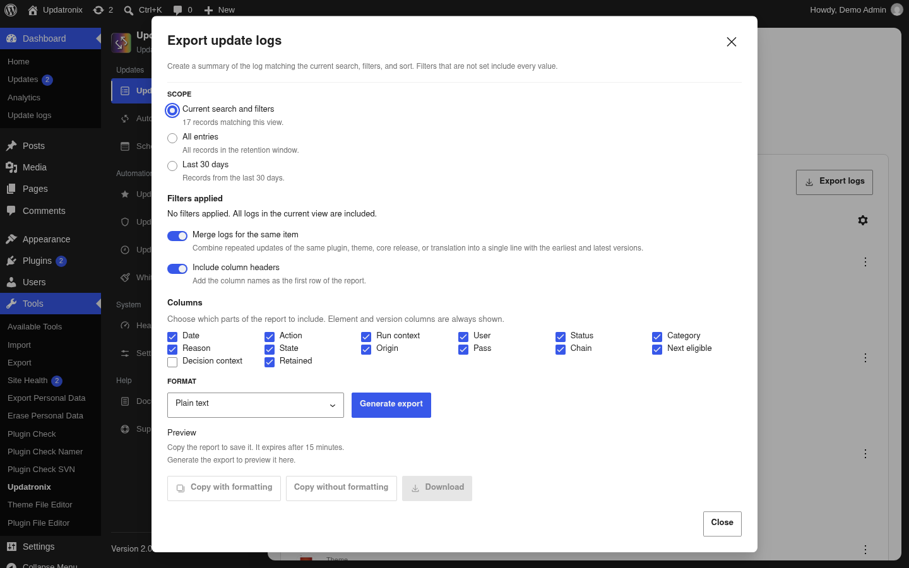

# Updatronix documentation

[Français](fr.md) · [Documentation index](../README.md)

| Field | Value |
|---|---|
| Version | 2.0.1 |
| WordPress | 6.2 or later (verified on 7.1.4) |
| PHP | 8.1 or later |
| Last verified | 2026-11-07 |
| Status | verified |

Updatronix logs updates to WordPress core, plugins, themes, and translations. It
also brings the automatic update settings together on one screen. The plugin
hooks into WordPress's own update engine; it does not replace it.

The plugin does not back up or restore your site, and it does not manage several
sites from one dashboard. It sends no analytics or telemetry. Requests for plugin
and theme details come from the native WordPress.org APIs. For a backup, use a
dedicated backup plugin and a restore procedure you have tested.

## Getting started

This guide is for site owners, freelancers, and agencies. Choose the task in
front of you.

| What you want to do | Section |
|---|---|
| Install the plugin and find the screens | [Install and open](#install-and-open) |
| See what changed on the site | [Update logs](#update-logs) |
| Choose what updates automatically | [Automatic updates](#automatic-updates) |
| Set the check frequency or hold new releases | [Schedule](#schedule) |
| See what needs attention | [Health](#health) |
| Configure the log and email | [Settings](#settings) |
| Run the plugin on a network | [Multisite](#multisite) |
| Know who can access what | [Roles and capabilities](#roles-and-capabilities) |
| Export the log | [Export logs](#export-logs) |
| Remove the plugin cleanly | [Uninstall](#uninstall) |
| Unblock a situation | [Troubleshooting](#troubleshooting) |

### Where to go next

The Pro edition, **Updatronix 3000**, adds automations. Its documentation is in
[Updatronix 3000 documentation](../updatronix-pro/en.md). This guide describes
the Free edition only.

Hooks, filters, REST routes, and the public PHP API are in the
[Updatronix developer API](../developer-api/en.md).

## Requirements

You need WordPress 6.2 or later and PHP 8.1 or later. This guide is verified on
WordPress 7.1.4 and PHP 8.4.

On a single site, you need an administrator account. On a multisite network, you
need a Super Admin account and a network-wide activation.

You can install the plugin from WordPress.org or upload the ZIP archive supplied
by the developer.

## Install and open

### Install and activate

1. In the administration, open **Plugins → Add New**.
2. Search for `updatronix`, or upload the ZIP archive.
3. Install and activate **Updatronix – Update Manager Enhanced**.

On a multisite network, activate the plugin from the **Network Admin**. An
activation on a subsite configures nothing: the plugin shows a notice that
points to the Network Admin.

### What activation does

Activation creates the log table, schedules the daily cleanup and the update
check, and adds the `manage_updatronix` capability to the administrator role on
a single site.

Deactivation removes the scheduled tasks. It keeps the log, the settings, and
the automatic update choices. Reactivating picks up the previous state.

### Open Updatronix

On a single site, two entries lead to the same screen: **Tools → Updatronix**
and **Dashboard → Update logs**.

On multisite, open **Updatronix** in the sidebar of the **Network Admin**.

### The eleven destinations and four groups

The plugin sidebar is the same on every screen. It contains four groups and
eleven destinations.

| Group | Destination | What it does |
|---|---|---|
| Updates | Update logs | Read, filter, and export the history. |
| Updates | Auto updates | Choose the automatic updates. |
| Updates | Schedule | Set the frequency, the time, and the hold. |
| Automations | Updatronix 3000 | Present the Pro edition and its license. |
| Automations | Update Shield | Pro destination. |
| Automations | Update Flow | Pro destination. |
| Automations | White label | Pro destination. |
| System | Health | See the checks and the items to review. |
| System | Settings | Set the log, the email, and the data. |
| Help | Documentation | Open the guides. |
| Help | Support | Open the WordPress.org forum. |

On a Free-only install, only the **Updatronix 3000** presentation destination
stays among the Pro destinations. The other three Pro destinations require an
active license. The sidebar shows a **Pro** badge on the 3000 destination.

### First steps

1. Open **Update logs** and check that logging is on. If it is off, the screen
   shows **Update logging is off. Turn it on in Settings to keep a history of
   updates.**
2. Open **Auto updates** to see what already updates without you.
3. Open **Schedule** if you want a specific frequency or time, or if you prefer
   to wait before installing a new release.
4. Finish with **Settings**: log retention, email addresses, and the data to
   remove on uninstall.

## Update logs

The log records the updates that go through the WordPress update engine. It is
not a backup, and it cannot undo an update.

### What is recorded

The log covers core, plugins, themes, and translations. It can also carry
system rows. An entry records the type, the action, the status, the origin, the
user or system that acted, the versions before and after, and the timestamp.

The common actions are `Update`, `Rollback`, `Install`, `Reinstall`, `Failed`,
`Uninstall`, and `Delete`. More actions appear when Updatronix 3000 is active;
the Pro guide describes them.

The states are `Done`, `Blocked`, `Waiting`, `Delayed`, `Skipped`, `Failed`,
`Needs review`, `Canceled`, and `Info`. The origins are `Manual`, `Automatic`,
`External`, `Site Health`, `System`, and `WP-CLI`.

An entry can also carry a decision: the reason, the decision state, the origin,
the stage, the pass, the chain, and the next eligible date. These fields explain
why an update was allowed, delayed, or blocked.

### One entry, from the row to the detail

The list offers the Item, Summary, Type, Day, Triggered by, Status, State,
Reason, Origin, Pass, Next eligible, Time, Action, and Run type columns. **View
options** sets the visible columns. A row's action menu offers **View details**
and **Delete**. **View details** opens the **Details** view.

The full view repeats the item, category, action, status, from version, to
version, triggered by, trigger, run type, date, decision, update details, and
technical details.

### Filter, search, and sort

The **Search update log** field searches titles and details. The **Add filter**
button opens the filters: `Type`, `Action`, `Status`, `Triggered by`, `Day`,
`Run type`, `Reason`, `State`, `Origin`, `Pass`, `Chain`, and `Next eligible`.

Filters combine and stay visible as chips. **Reset** clears them all. The default
sort shows the most recent entries first; the reverse order is available.

The list shows 25 entries per page. The other sizes show more entries, and
**Load more** adds pages up to 200 entries.

### Delete an entry

1. Open the row's action menu.
2. Choose **Delete**.
3. Confirm with **Delete permanently**.

Deleting removes the row from the log. It does not touch the site or the update
the row describes. If the database does not answer, the screen shows **The log
entry could not be deleted. Try again or check your database connection.**

### Retention and cleanup

Retention is set in **Settings**, with **Retention period (days)**. The value runs
from 1 to 365 days; the default is 90. A daily cleanup removes older entries.
The log header shows the current period, for example **Retention: 90 days**.

### What the log cannot show

The log does not show updates that happened before activation, or updates made
outside WordPress by FTP or by the host's tool. An external update appears only
when the deployment script calls the external logging API, described in
[For developers](#for-developers).

The log cannot undo an update. To go back, use a backup.

## Automatic updates

The **Auto updates** screen gathers the automatic update decisions. Your choices
are written to WordPress's native options (`auto_update_*`), so they stay in
place if you uninstall the plugin.

Changes stay local until **Save changes**. Nothing installs at the moment of the
click: the next scheduled check uses the saved settings.

### WordPress core

The **Core update mode** section offers three choices:

- **Minor releases only**: security and maintenance releases, for example
  7.1 → 7.1.1.
- **All releases**: major versions included. Test the site before enabling this
  choice.
- **Manual updates only**: Updatronix records updates but does not install them.

If `WP_AUTO_UPDATE_CORE` is defined in `wp-config.php`, the choice is locked. The
panel explains that you must edit the file to change the decision.

### Plugins and themes

The **Plugins** and **Themes** sections list the installed items. Each row shows
the `Active` or `Inactive` state, the version, and a description, with the
**Auto updates** switch.

An item can show that no update data is available when automatic updates are not
possible, for example when it is not hosted on WordPress.org. An item can also be
locked by a Pro automation; the row gives the reason, and the Pro guide
describes the mechanism. The **View on WordPress.org**, **Visit plugin site**,
and **Visit theme site** links open the item's page.

### Translations

The **Translations** section contains one switch, **Automatic translation
updates**. WordPress downloads language packs automatically by default; turn the
switch off to stop it. The description notes that language packs follow the core
update mode.

### When a wp-config.php constant decides

Some `wp-config.php` constants stop automatic updates at the WordPress level:

| Constant | Effect |
|---|---|
| `AUTOMATIC_UPDATER_DISABLED` (true) | All automatic updates are off. |
| `DISALLOW_FILE_MODS` (true) | WordPress cannot change files; automatic updates are blocked. |
| `WP_AUTO_UPDATE_CORE` | Decides which core versions install automatically; the core choice is locked here. |
| `DISABLE_WP_CRON` | Scheduled tasks do not run during visits; the switches stay available, but nothing fires on time. |

The notices are informational and can be dismissed. The constant stays in place.

### What the native screens show

The WordPress **Plugins**, **Themes**, and **Updates** screens show the automatic
update state and a summary of the next run. During a hold, they also show a
notice that points to Updatronix.

## Schedule

The **Schedule** screen sets two behaviors: the frequency and time of the
checks, then the delay before a new release installs automatically.

### Frequency and preferred time

The **Frequency** list offers:

- **WordPress default**: WordPress keeps its own schedule.
- **Daily**, **Twice daily**, **Hourly**, and **Weekly**: Updatronix takes over.

The daily, twice-daily, and weekly choices use the **Hour** and **Minute** you
set. The timezone is the site timezone, for example `Europe/Paris`. The hourly
choice and the WordPress default ignore the preferred time; the saved time stays
available when you switch back.

### Next run

The **Next run** card shows **Next automatic check: …**. That date is the next
check, not an install. **Run a check now** refreshes the update data; the action
does not start the hold, which begins at the next automatic run.

If WP-Cron is disabled, a **WP-Cron is disabled** notice explains that the check
will not start until WP-Cron is restored or a system cron job calls WordPress. A
second notice notes that other WP-Cron tasks can delay the check.

### Hold new installs

The **Hold period (days)** field accepts a whole number from 0 to 365. At 0, the
hold is off: **Off. New releases install on the next automatic run.** Above 0,
WordPress waits the full number of days after the first automatic detection
before installing.

Each item and each version keeps its own counter. The hold applies to automatic
installs only: a manual update installs immediately. While the hold runs, the log
records a **Delayed** entry with the reason `Held by the update schedule` and a
date in **Next eligible**.

The rule applies to every automatic core update; WordPress does not mark which
updates are security updates.

### WP-Cron

WP-Cron is WordPress's built-in scheduler. If `DISABLE_WP_CRON` is defined in
`wp-config.php`, tasks no longer run during visits. You then need a system cron
job that calls `wp-cron.php` at a regular interval; otherwise neither the checks
nor the hold work.

## Health

Health is a Free destination. It gathers the checks that decide the next update
and the actions that bring a failed item back.

### The checks

The checks cover the WordPress version, the PHP version, disk space, WP-Cron, the
update lock, automatic retries, automatic-update execution, and the last run.
Each card shows a **Good**, **Attention**, or **Critical** state and a sentence
that explains the result.

The header summarizes the situation with the number of failing checks, the
number of passing checks, and the time of the last check. **Run check** reruns
the set.

### Issues to review

The **Issues to review** section lists the checks that need an action. A failed
update links to **Review failed updates**, which opens the filtered log. The
**Open update log** link opens the full log.

### Retry an update

You can retry a failed update from Health with **Retry** or **Retry update**. The
screen names the item, the version, the attempt count, and the retry state. A
retry that is already scheduled shows **A retry for this item is already
queued.**; a successful retry shows **Retry finished.**

### Diagnostics

**View diagnostics** opens a report with the WordPress version, the PHP version,
the database, the server, the memory limit, the maximum execution time, the
upload size, the timezone, multisite, the Updatronix version, the log table
state, the update check, and logging. You can copy or download the report.

### Recently fixed

The **Recently fixed** section lists the items that failed and were then fixed,
with the item, version, resolution, and date. It is the evidence after an
automatic or manual recovery.

## Settings

The **Settings** screen sets logging, update emails, and the data kept on
uninstall.

### Logging and retention

**Logging** contains the **Keep an update log** switch, which records every
installed, failed, or skipped update. The **Retention period (days)** field
accepts 1 to 365 days; the default is 90. A daily cleanup removes older entries.

If logging is off, the log shows **Update logging is off. Turn it on in Settings
to keep a history of updates.** Existing entries stay until they expire or are
deleted.

### Email notifications

**Email notifications** manages WordPress's native emails. Updatronix does not
create its own messages: it redirects and filters WordPress's messages.

The **Email addresses** field accepts several addresses. Type an address and
press Enter to add it. WordPress drops invalid addresses on save; if no valid
address remains, it uses the site's administration address.

**Notify me about** offers four types:

- **Core updates** covers success, failure, manual intervention, and critical.
- **Plugin and theme updates**: one combined email for automatic updates.
- **Developer details**: the development report, with core, plugins, themes, and
  translations.
- **Technical alerts**: the technical email sent when the site enters recovery
  mode.

**Recovery mode** is always on. WordPress sends an email to the site
administrator after a fatal error, even when the other notifications are off.

WordPress sends one email per run: the detailed report when it exists, otherwise
the usual summary.

### Turn off all update emails

**Turn off all update emails** stops the core, plugin, theme, and development
emails. Recovery mode is not affected. The switch is on by default: update emails
do not go out until you turn it off.

To receive notifications, turn off **Turn off all update emails**, add at least
one address, and check the types you want.

### Data on uninstall

**Data** contains **Delete all data on uninstall**, off by default. While it is
off, a reinstall finds the log, the settings, and the schedule.

When it is on, deletion removes the logs, the settings, and the schedules. The
screen warns that the operation is permanent. The [Uninstall](#uninstall)
section lists what goes and what stays.

### Automatic translations

The translation switch is in **Auto updates**, in the **Translations** section.
It is not set in **Settings**.

## Multisite

Updatronix runs at the network level. The sites share the same log, settings,
and schedule.

### Activate network-wide

1. In the **Network Admin**, open **Plugins**.
2. Activate **Updatronix – Update Manager Enhanced** for the whole network.

An activation on a subsite configures nothing. The plugin shows a notice in the
Network Admin and points to **Network Admin → Updatronix**.

### Network-level data and settings

The log lives in one table, on the main site. Each row keeps the ID of the site
it concerns. Settings, schedule, hold, and automatic update choices also live at
the network level; a change applies to every site.

Automatic updates run on the main site, and the log records them there. Manual
updates launched from the **Network Admin** follow the same path. The log also
records an update launched from the command line in a subsite context, with its
site.

### Where the screens are

On multisite, **Updatronix** appears in the sidebar of the **Network Admin**,
reserved for Super Admins. Subsites have no Updatronix menu or screen.

### Scheduled tasks and one unified log

The daily cleanup and the update check run once, on the main site. The log stays
one history, across all origins, with no per-site view.

### Who can manage Updatronix

Super Admins have control. The `manage_updatronix` capability is not granted to
subsite roles. A local administrator cannot reach the screens.

## Roles and capabilities

Updatronix protects its screens and data with the `manage_updatronix`
capability.

### Single site

On activation, Updatronix adds the capability to the administrator role.
Administrators open every screen and can read, filter, export, delete, set the
automatic updates, the schedule, and the notifications.

On an install that was upgraded rather than activated, Updatronix adds the
capability on the next page load. To open management to another role, add
`manage_updatronix` to that role with a role management plugin. The Updatronix
entry then appears under **Tools**.

Deleting the plugin removes the capability from the administrator role when the
delete-data option is on.

### Multisite

Only Super Admins open the network screen. Updatronix does not grant the
capability to subsite roles, and the interface does not load on a subsite.

### What each action requires

| Action | Capability or context |
|---|---|
| Open the Updatronix screen | `manage_updatronix` on a single site; Super Admin on multisite |
| Read, filter, and export the log | The same capability |
| Delete an entry | The same capability |
| Change automatic updates, schedule, or settings | The same capability |

## Export logs

**Export logs** produces a text report from the entries that pass the filters.

### What the export produces

1. Apply the filters you want. Empty filters take every value.
2. Click **Export logs**.
3. In the **Export update logs** dialog, choose the scope: the filtered rows or
   the whole log.
4. Choose **Generate export**.
5. Copy the report with the copy button, or download it.

The report carries a **Filters applied** header that lists the filters used, or
says that none were applied.

### Filters and merging

**Merge logs for the same item** combines repeated updates of one item on one
row, with the first and last version. Without merging, each entry keeps its own
row.

### Columns

The report always includes **Element** and **Version**. **Date** is optional.
The other available columns are `Action`, `Run context`, `User`, `Status`,
`Category`, `Reason`, `State`, `Origin`, `Pass`, `Chain`, `Next eligible`,
`Decision context`, and `Retained`.

### Expiry and limits

The report lives for 15 minutes: **Export ready. Copy the report to save it. It
expires after 15 minutes.** After that, the session expires and you must start a
new export.

Updatronix limits exports to 30 per minute and 300 per hour, per user and per
site. Too many requests in a row show **Too many exports started recently. Wait
a minute, and then try again.** Updatronix stops an export that is too large:
**The export is too large and was stopped. Narrow your filters to export fewer
logs.** The limit is 250,000 rows. The search accepts 200 characters at most.

### Pro formats

The Free edition produces a plain-text report. CSV, JSON, and XML belong to
**Updatronix 3000**. The Pro guide describes those formats.

## Uninstall

Deactivating and deleting do not have the same consequences.

### Deactivate or delete

**Deactivate** stops the plugin and removes its scheduled tasks. The log, the
settings, the schedule, and the automatic update choices stay in place.
Reactivating picks up the previous state.

**Delete** runs the uninstall routine. By default, it removes nothing: the
**Delete all data on uninstall** switch must be on in **Settings → Data**.

### What deletion removes

When the option is on, deletion removes:

- the log table and every entry in it;
- the Updatronix settings, the schedule, the export history, and the internal
  markers;
- the daily cleanup task and the temporary data;
- the `manage_updatronix` capability from the administrator role on a single
  site;
- legacy per-subsite tables on multisite.

### What deletion keeps

Updatronix does not touch WordPress's native options (`auto_update_plugins`,
`auto_update_themes`, `auto_update_core_*`). After deletion, WordPress continues
to update the items you enabled. To stop that, change those options before
deletion, or after from **Dashboard → Updates**.

WordPress's own update history and email settings made elsewhere stay in place.
Updatronix only redirected and filtered the native emails while it was active.

### Multisite

On multisite, deactivate the plugin for the whole network first, then delete it
from the **Network Admin**. The uninstall routine destroys network data only
from the Network Admin or WP-CLI; a subsite administrator cannot delete it.

## Troubleshooting

### The log stays empty

Open **Settings** and check **Keep an update log**. While the switch is off,
Updatronix writes no entries. If logging is on and the table shows **No update
logs yet. Entries appear after WordPress runs an update.**, no update has run
since activation. The log cannot show what happened before.

### Entries stay "Delayed"

The hold is working. WordPress waits the configured number of full days after it
sees a new release. To install sooner, lower **Hold period (days)** in
**Schedule**, or set it to 0. A manual update starts immediately. The **Next
eligible** date gives the next eligibility; the countdowns on the native screens
announce the next check, not the install.

### Nothing runs on schedule

The tasks rely on WP-Cron, or on a system cron job when WP-Cron is disabled.

1. Check that `DISABLE_WP_CRON` is not defined in `wp-config.php`.
2. If it is defined, set up a system cron job that calls `wp-cron.php` regularly.
3. Check that a cache or an external service does not block `wp-cron.php`.
4. In **Schedule**, check the frequency and the time; the **WP-Cron is disabled**
   notice flags the problem.

### Controls are locked

A read-only control means a `wp-config.php` constant decides for you:

- `WP_AUTO_UPDATE_CORE` locks the core mode.
- `AUTOMATIC_UPDATER_DISABLED` (true) stops every automatic update.
- `DISALLOW_FILE_MODS` (true) blocks every file change.

Back up `wp-config.php` before editing it, and remove only the constant in
question.

### Emails do not arrive

1. Check that **Turn off all update emails** is off.
2. Check that at least one valid address is present in **Email addresses**.
3. Check the types checked in **Notify me about**.
4. Check the site's spam filter and SMTP service.

Recovery mode keeps sending its emails to the site administrator, even when the
other notifications are off.

### The export fails

- **Too many exports started recently. Wait a minute, and then try again.**:
  wait a minute.
- **The export is too large and was stopped. Narrow your filters to export fewer
  logs.**: narrow the filters.
- **This export session has expired. Start a new export.**: start the export
  again; the report lives for 15 minutes.

### Multisite

- **Updatronix was activated on a subsite, but it only works from the Network
  Admin.**: activate the plugin for the whole network.
- No Updatronix menu on a subsite: that is intentional. Use the **Network
  Admin**.
- Settings seem to have no effect: on multisite, they apply to the whole network
  and are managed from the **Network Admin**.

### Masked paths

Updatronix removes server paths from log entries. The detail says so:
**Updatronix removed server paths from this entry for security.** The versions,
the action, the status, and the message stay readable.

### The interface does not load

If the screen stays on **Loading your Updatronix settings**, the JavaScript
bundle is probably missing or incomplete. Reinstall the plugin from the
distributed archive or from WordPress.org. If the screen stays frozen, reload
the page and open the browser console: a blocked request appears there.

### Deleting an entry fails

The screen shows **The log entry could not be deleted. Try again or check your
database connection.** Check that the database answers and that the log table
exists. If the table is gone, deactivate and reactivate the plugin: activation
creates it again.

## For developers

The public `updatronix_after_log` action fires after an entry is saved. It
receives the entry ID and the log data.

To log an update made outside WordPress, call `Updatronix_External_Log::log()`
after deployment. The method accepts the item name, the source, the type, the
versions, the status, and a message. The `updatronix_external_update_logged`
action fires after the entry is saved. The API does not detect an arbitrary FTP
change: the deployment script must call it.

The REST routes live under `updatronix/v1`. The full list of hooks, filters,
routes, classes, and the data model is in the
[Updatronix developer API](../developer-api/en.md).

## Documentation and support

The **Documentation** destination opens three cards: the Updatronix
documentation, the Updatronix 3000 documentation, and the WordPress update
system reference. The cards open in a new tab on the developer's site.

The **Support** destination lists four preparations: update WordPress and
Updatronix, include the item, versions, error code, and time from the log,
reproduce the problem on a test site if possible, and search for an existing
discussion. The **Open the support forum** button opens the WordPress.org forum.

To ask a question or report a problem, use the
[Updatronix support forum](https://wordpress.org/support/plugin/updatronix/).
Threads are public: never post a license key or a password. If the plugin helps
you, you can [leave a review](https://wordpress.org/plugins/updatronix/#reviews).
