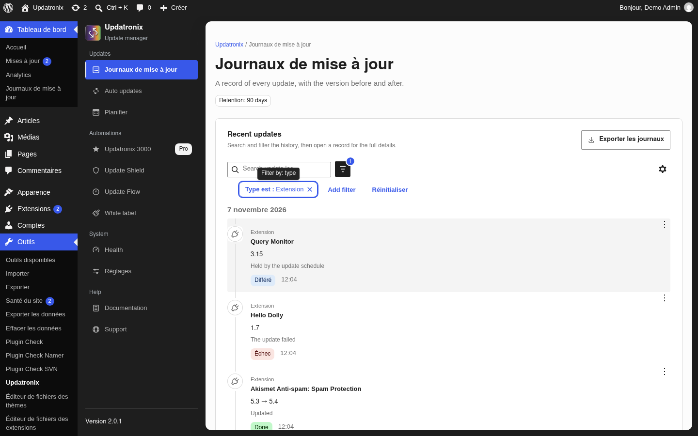
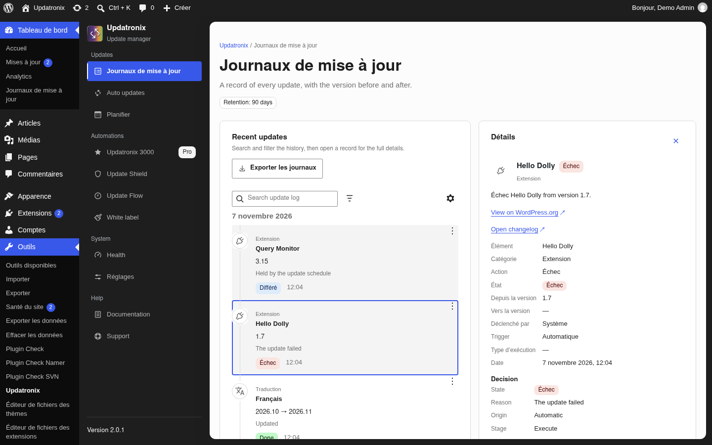
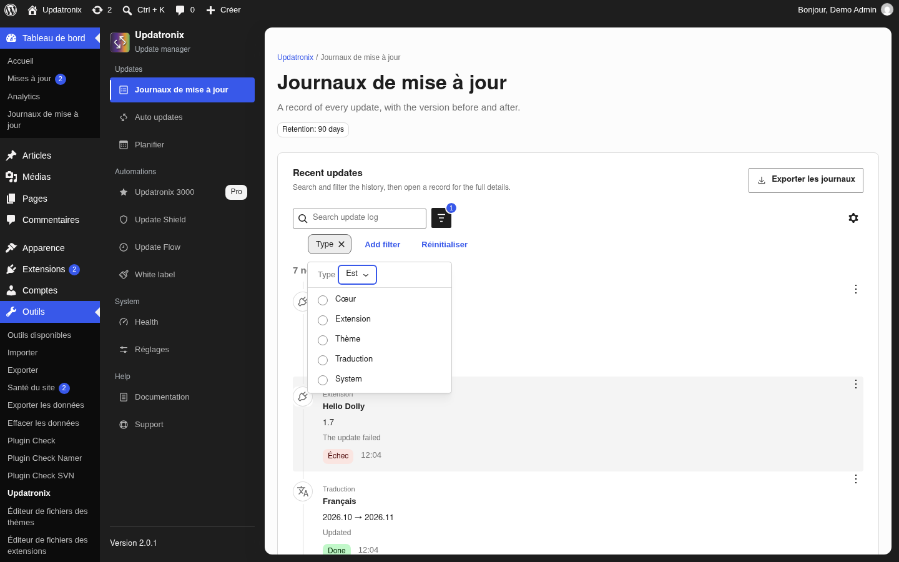
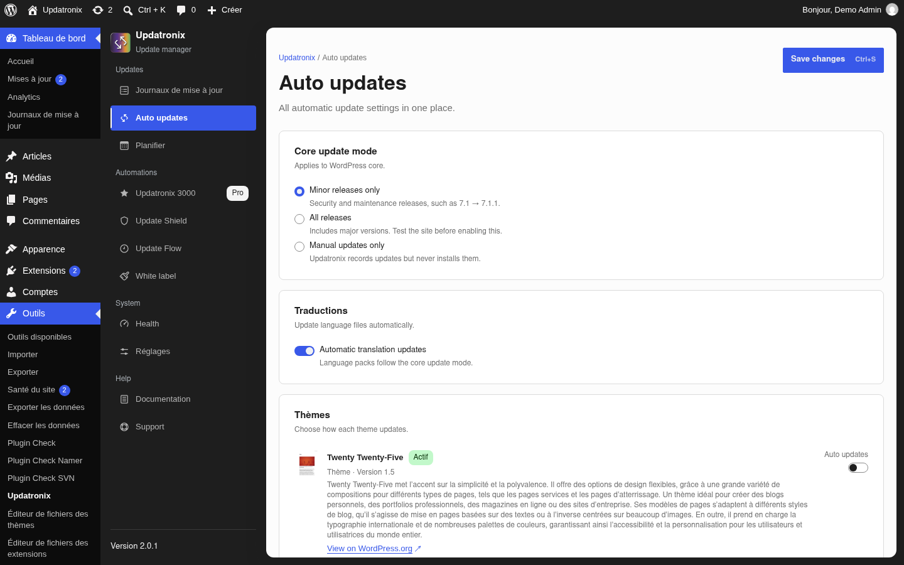
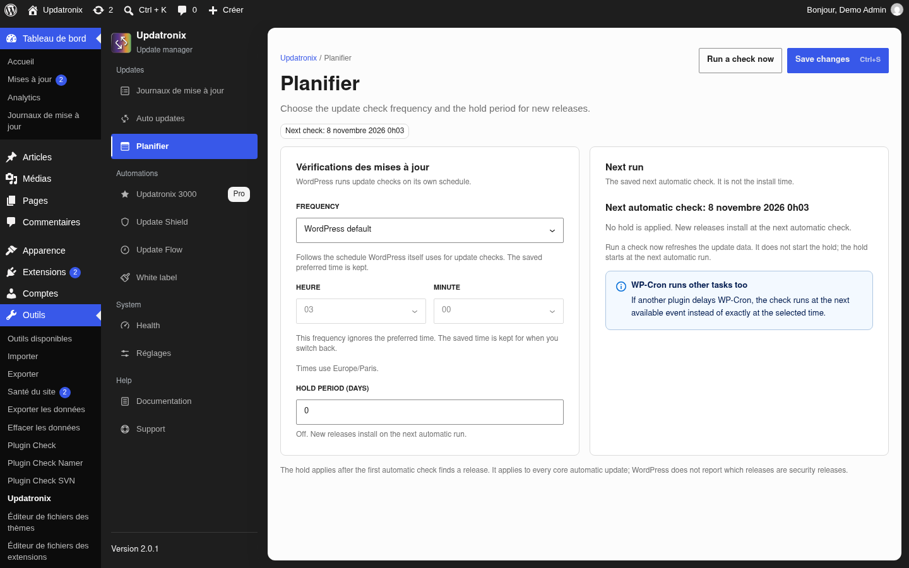
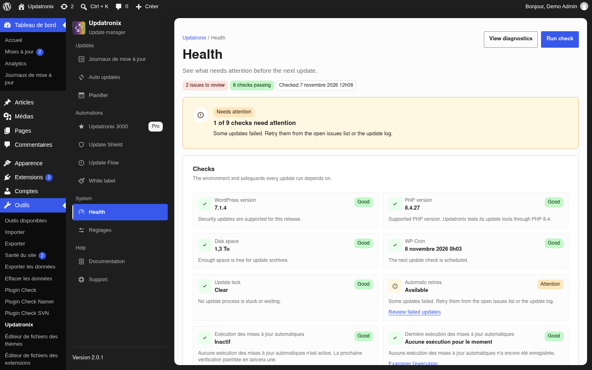
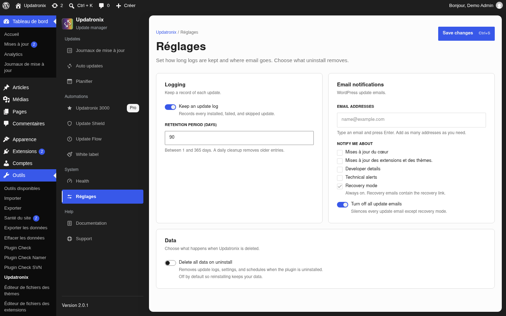
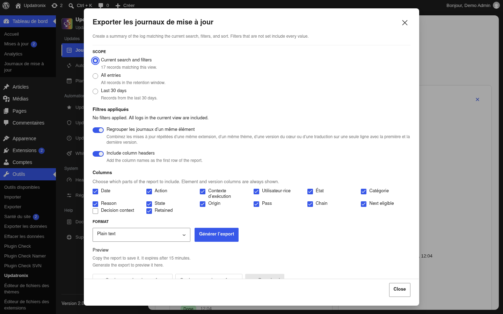

# Documentation Updatronix

[English](en.md) · [Index de la documentation](../README.md)

| Champ | Valeur |
|---|---|
| Version | 2.0.1 |
| WordPress | 6.2 ou plus récent (vérifié sur 7.1.4) |
| PHP | 8.1 ou plus récent |
| Dernière vérification | 2026-11-07 |
| Statut | vérifié |

Updatronix journalise les mises à jour du cœur, des extensions, des thèmes et des
traductions. Il rassemble aussi les réglages de mise à jour automatique sur un
seul écran. L’extension se branche sur le moteur de mise à jour de WordPress ;
elle ne le remplace pas.

Ce que l’extension ne fait pas : elle ne sauvegarde pas le site, elle ne le
restaure pas, elle ne pilote pas plusieurs sites depuis un tableau de bord, et
elle n’envoie ni analyse d’audience ni télémétrie. Les requêtes vers
WordPress.org viennent des API natives de WordPress. Pour une sauvegarde,
utilisez une extension dédiée et une procédure de restauration que vous avez
testée.

Le paquet français installé ne couvre pas encore tous les libellés de la 2.0.1.
Quand un libellé reste en anglais à l’écran, ce guide le cite tel quel et le
signale. Les captures montrent cet état.

## Par où commencer

Ce guide s’adresse aux personnes qui administrent un site : propriétaires,
indépendants, agences. Choisissez la tâche qui vous occupe.

| Ce que vous voulez faire | Section |
|---|---|
| Installer l’extension et repérer les écrans | [Installer et ouvrir l’extension](#installer-et-ouvrir-lextension) |
| Voir ce qui a changé sur le site | [Journal des mises à jour](#journal-des-mises-à-jour) |
| Choisir ce qui se met à jour tout seul | [Mises à jour automatiques](#mises-à-jour-automatiques) |
| Régler la fréquence ou différer une nouveauté | [Planification](#planification) |
| Voir ce qui demande attention | [Santé](#santé) |
| Configurer le journal et les e-mails | [Réglages](#réglages) |
| Faire tourner l’extension sur un réseau | [Multisite](#multisite) |
| Savoir qui a accès à quoi | [Rôles et capacités](#rôles-et-capacités) |
| Exporter le journal | [Exporter les journaux](#exporter-les-journaux) |
| Retirer proprement l’extension | [Désinstaller](#désinstaller) |
| Débloquer une situation | [Résolution des problèmes](#résolution-des-problèmes) |

### Vers où aller ensuite

L’édition Pro, **Updatronix 3000**, ajoute des automatisations. Sa documentation
est dans [Documentation Updatronix 3000](../updatronix-pro/fr.md). Ce guide ne
décrit que l’édition gratuite.

Les hooks, filtres, routes REST et l’API PHP publique sont dans
[API développeur Updatronix](../developer-api/fr.md).

## Prérequis

Il faut WordPress 6.2 ou plus récent et PHP 8.1 ou plus récent. Le guide est
vérifié sur WordPress 7.1.4 et PHP 8.4.

Sur un site simple, il faut un compte administrateur. Sur un réseau multisite, il
faut un compte Super administrateur et une activation au niveau du réseau.

Vous pouvez installer l’extension depuis WordPress.org ou téléverser l’archive
ZIP fournie par l’éditeur.

## Installer et ouvrir l’extension

### Installer et activer

1. Dans l’administration, ouvrez **Extensions → Ajouter une extension**.
2. Cherchez `updatronix`, ou téléversez l’archive ZIP.
3. Installez puis activez **Updatronix – Update Manager Enhanced**.

Sur un réseau multisite, activez l’extension depuis l’**Administration du
réseau**. Une activation sur un sous-site ne configure rien : l’extension
affiche un avis qui renvoie vers l’administration du réseau.

### Ce que déclenche l’activation

L’activation crée la table du journal, programme le nettoyage quotidien et la
vérification des mises à jour, puis ajoute la capacité `manage_updatronix` au
rôle administrateur sur un site simple.

La désactivation retire les tâches planifiées. Elle conserve le journal, les
réglages et les choix de mise à jour automatique. Une réactivation reprend
l’état précédent.

### Ouvrir Updatronix

Sur un site simple, deux entrées mènent au même écran : **Outils → Updatronix**
et **Tableau de bord → Journaux de mise à jour**.

Sur multisite, ouvrez **Updatronix** dans la barre latérale de
l’**Administration du réseau**.

### Les onze destinations et les quatre groupes

La barre latérale de l’extension est la même sur tous les écrans. Elle contient
quatre groupes et onze destinations.

| Groupe | Destination | Rôle |
|---|---|---|
| Updates | Journaux de mise à jour | Lire, filtrer et exporter l’historique. |
| Updates | Auto updates | Choisir les mises à jour automatiques. |
| Updates | Planifier | Régler la fréquence, l’heure et le report. |
| Automations | Updatronix 3000 | Présenter l’édition Pro et sa licence. |
| Automations | Update Shield | Destination Pro. |
| Automations | Update Flow | Destination Pro. |
| Automations | White label | Destination Pro. |
| System | Health | Voir les contrôles et les points à examiner. |
| System | Réglages | Régler le journal, les e-mails et les données. |
| Help | Documentation | Ouvrir les guides. |
| Help | Support | Ouvrir le forum WordPress.org. |

Sur une installation gratuite, seule la destination de présentation
**Updatronix 3000** reste parmi les destinations Pro. Les trois autres
destinations Pro demandent une licence active. La barre latérale affiche un
badge **Pro** sur la destination 3000.

Les groupes restent en anglais dans le paquet français actuel (`Updates`,
`Automations`, `System`, `Help`). Les libellés `Auto updates`, `Update Shield`,
`Update Flow`, `White label` et `Health` restent aussi en anglais.

### Premiers pas

1. Ouvrez **Journaux de mise à jour** et vérifiez que la journalisation est
   active. Si elle est coupée, l’écran affiche **Update logging is off. Turn it
   on in Settings to keep a history of updates.**
2. Ouvrez **Auto updates** pour voir ce qui se met déjà à jour sans vous.
3. Ouvrez **Planifier** si vous voulez une fréquence ou une heure précise, ou si
   vous préférez attendre avant d’installer une nouveauté.
4. Terminez par **Réglages** : conservation du journal, adresses e-mail et
   données à la désinstallation.

## Journal des mises à jour

Le journal garde une trace des mises à jour qui passent par le moteur de
WordPress. Il ne remplace pas une sauvegarde et ne peut pas annuler une mise à
jour.

### Ce qui est enregistré

Le journal couvre le cœur, les extensions, les thèmes et les traductions ; il
peut aussi porter des lignes système. Une entrée indique le type, l’action,
l’état, l’origine, l’utilisateur ou le système qui a agi, les versions avant et
après, et l’horodatage.

Les actions courantes sont `Update`, `Rollback`, `Install`, `Reinstall`,
`Failed`, `Uninstall` et `Delete`. Des actions supplémentaires apparaissent
lorsqu’Updatronix 3000 est actif ; le guide Pro les décrit.

Les états sont `Done`, `Blocked`, `Waiting`, `Delayed`, `Skipped`, `Failed`,
`Needs review`, `Canceled` et `Info`. Les origines sont `Manual`, `Automatic`,
`External`, `Site Health`, `System` et `WP-CLI`.

Une entrée peut aussi porter une décision : la raison, l’état de décision,
l’origine, l’étape, le passage, la chaîne et la prochaine date d’éligibilité.
Ces champs expliquent pourquoi une mise à jour a été autorisée, retardée ou
bloquée.

### Une entrée, de la ligne au détail

La liste propose les colonnes élément, résumé, type, jour, déclencheur, état,
raison, origine, passage, prochaine éligibilité, heure, action et type
d’exécution. **View options** règle les colonnes visibles. Le menu d’actions
d’une ligne propose **View details** et **Delete**. **View details** ouvre la
fiche **Détails**.

La fiche complète reprend l’élément, la catégorie, l’action, l’état, la version
de départ et la version d’arrivée, le déclencheur, le type d’exécution, la date,
la décision, les détails de la mise à jour et les détails techniques. Le paquet
français traduit une partie des libellés de la fiche (`Détails`, `Élément`,
`Catégorie`, `État`, `Depuis la version`, `Vers la version`, `Déclenché par`,
`Origine`, `Date`, `Décision`).

### Filtrer, rechercher, trier

La recherche **Search update log** porte sur les titres et les détails. Le
bouton **Add filter** ouvre les filtres : `Type`, `Action`, `Status`,
`Triggered by`, `Day`, `Run type`, `Reason`, `State`, `Origin`, `Pass`, `Chain`
et `Next eligible`.

Les filtres se combinent et restent visibles sous forme de tags.
**Réinitialiser** les efface tous. Le tri par défaut affiche les entrées les plus
récentes d’abord ; l’ordre inverse est disponible.

La liste affiche 25 entrées par page. Les tailles proposées permettent d’en
afficher davantage, et **Load more** ajoute des pages jusqu’à 200 entrées.

### Supprimer une entrée

1. Ouvrez le menu d’actions de la ligne.
2. Choisissez **Delete**.
3. Confirmez avec **Delete permanently**.

La suppression retire la ligne du journal. Elle ne touche ni le site ni la mise
à jour décrite. Si la base ne répond pas, l’écran affiche **The log entry could
not be deleted. Try again or check your database connection.**

### Conserver et purger

La conservation se règle dans **Réglages**, avec **Retention period (days)**. La
valeur va de 1 à 365 jours ; la valeur par défaut est 90. Un nettoyage quotidien
supprime les entrées plus anciennes. L’en-tête du journal rappelle la durée en
cours, par exemple **Retention: 90 days**.

### Ce que le journal ne peut pas montrer

Le journal ne montre pas les mises à jour antérieures à l’activation, ni celles
faites en dehors de WordPress par FTP ou par l’outil de l’hébergeur. Une mise à
jour externe n’apparaît que si le script de déploiement appelle l’API de
journalisation externe, décrite dans [Développeurs](#développeurs).

Le journal ne peut pas annuler une mise à jour. Pour revenir en arrière, utilisez
une sauvegarde.

## Mises à jour automatiques

L’écran **Auto updates** rassemble les décisions de mise à jour automatique. Vos
choix sont écrits dans les options natives de WordPress (`auto_update_*`) ; ils
restent donc en place si vous désinstallez l’extension.

Les modifications restent locales jusqu’à **Save changes**. Rien ne s’installe au
moment du clic : la prochaine vérification planifiée utilise les réglages
enregistrés.

### Cœur de WordPress

La section **Core update mode** propose trois choix :

- **Minor releases only** : les versions de sécurité et de maintenance, par
  exemple 7.1 → 7.1.1.
- **All releases** : les versions majeures comprises. Testez le site avant
  d’activer ce choix.
- **Manual updates only** : Updatronix enregistre les mises à jour mais ne les
  installe pas.

Si `WP_AUTO_UPDATE_CORE` est définie dans `wp-config.php`, ce choix est
verrouillé. Le panneau explique qu’il faut modifier le fichier pour changer la
décision.

### Extensions et thèmes

Les sections **Extensions** et **Thèmes** listent les éléments installés. Chaque
ligne affiche l’état `Actif` ou `Inactif`, la version et une description, avec
l’interrupteur **Auto updates**.

Un élément peut afficher **Unavailable** lorsque les mises à jour automatiques ne
sont pas possibles, par exemple s’il n’est pas hébergé sur WordPress.org. Un
élément peut aussi être verrouillé par une automatisation de l’édition Pro ; la
ligne donne la raison, et le guide Pro décrit le mécanisme. Les liens **View on
WordPress.org**, **Visit plugin site** et **Visit theme site** ouvrent la fiche
de l’élément.

Dans la capture, `Core update mode`, `Minor releases only`, `All releases`,
`Manual updates only`, `Auto updates` et `View on WordPress.org` restent en
anglais ; `Traductions`, `Thèmes` et `Actif` sont traduits.

### Traductions

La section **Traductions** contient un seul interrupteur, **Automatic
translation updates**. WordPress télécharge les paquets de langue
automatiquement par défaut ; désactivez l’interrupteur pour l’en empêcher. La
description précise que les paquets suivent le mode de mise à jour du cœur.

### Quand une constante de wp-config.php décide

Certaines constantes de `wp-config.php` coupent les mises à jour automatiques au
niveau de WordPress :

| Constante | Effet |
|---|---|
| `AUTOMATIC_UPDATER_DISABLED` (true) | Toutes les mises à jour automatiques sont coupées. |
| `DISALLOW_FILE_MODS` (true) | WordPress ne peut plus modifier de fichiers ; les mises à jour automatiques sont bloquées. |
| `WP_AUTO_UPDATE_CORE` | Décide quelles versions du cœur s’installent seules ; le choix du cœur est verrouillé ici. |
| `DISABLE_WP_CRON` | Les tâches planifiées ne partent plus pendant les visites ; les interrupteurs restent accessibles, mais rien ne se déclenche au bon moment. |

Les avis sont informatifs et se ferment. La constante reste en place.

### Ce que montrent les écrans natifs

Les écrans **Extensions**, **Thèmes** et **Mises à jour** de WordPress affichent
l’état de mise à jour automatique et un résumé de la prochaine exécution. Pendant
un report, ils affichent aussi un avis qui renvoie vers Updatronix.

## Planification

L’écran **Planifier** règle deux comportements : la fréquence et l’heure des
vérifications, puis le délai avant l’installation automatique d’une nouveauté.

### Fréquence et heure préférée

La liste **Frequency** propose :

- **WordPress default** : WordPress garde sa planification.
- **Daily**, **Twice daily**, **Hourly** et **Weekly** : Updatronix prend la
  main.

Les choix quotidiens, biquotidiens et hebdomadaires utilisent l’heure choisie
dans **Heure** et **Minute**. Le fuseau horaire est celui du site, par exemple
`Europe/Paris`. Les choix horaires et la planification WordPress ignorent
l’heure préférée ; l’heure enregistrée reste disponible pour un retour.

### Prochaine exécution

La carte **Next run** affiche **Next automatic check: …**. Cette date est celle
de la prochaine vérification, pas celle d’une installation. **Run a check now**
rafraîchit les données de mise à jour ; l’action ne démarre pas le report, qui
commence à la prochaine exécution automatique.

Si WP-Cron est désactivé, un avis **WP-Cron is disabled** explique que la
vérification ne partira pas tant que WP-Cron n’est pas rétabli ou qu’une tâche
cron système n’appelle pas WordPress. Un second avis rappelle que les autres
tâches WP-Cron peuvent retarder la vérification.

### Différer les installations

Le champ **Hold period (days)** accepte un nombre entier de 0 à 365. À 0, le
report est coupé : **Off. New releases install on the next automatic run.**
Au-delà de 0, WordPress attend le nombre de jours complets après la première
détection automatique avant d’installer.

Chaque élément et chaque version gardent leur propre compteur. Le report ne
concerne que les installations automatiques : une mise à jour lancée à la main
s’installe tout de suite. Pendant l’attente, le journal enregistre une entrée
**Différé** avec la raison `Held by the update schedule` et une date dans
**Next eligible**.

La règle s’applique à toutes les mises à jour automatiques du cœur ; WordPress
n’indique pas lesquelles sont des mises à jour de sécurité.

### WP-Cron

WP-Cron est l’ordonnanceur intégré de WordPress. Si `DISABLE_WP_CRON` est définie
dans `wp-config.php`, les tâches ne partent plus pendant les visites. Il faut
alors une tâche cron système qui appelle `wp-cron.php` à intervalle régulier,
sans quoi ni les vérifications ni le report ne fonctionnent.

## Santé

Health est une destination gratuite. Elle rassemble les contrôles qui
conditionnent la prochaine mise à jour et les actions pour reprendre un élément
en échec.

### Les contrôles

Les contrôles couvrent la version de WordPress, la version de PHP, l’espace
disque, WP-Cron, le verrou de mise à jour, les nouvelles tentatives automatiques,
l’exécution des mises à jour automatiques et la dernière exécution. Chaque carte
indique un état **Good**, **Attention** ou **Critical** et une phrase qui
explique le résultat.

Le bandeau supérieur résume la situation : nombre de contrôles en échec, nombre
de contrôles qui passent et heure de la dernière vérification. **Run check**
relance l’ensemble.

### Les points à examiner

La section **Issues to review** liste les contrôles qui demandent une action. Un
échec de mise à jour renvoie vers **Review failed updates**, qui ouvre le journal
filtré. Le lien **Open update log** ouvre le journal complet.

### Relancer une mise à jour

Vous pouvez relancer une mise à jour en échec depuis Health avec **Retry** ou
**Retry update**. L’écran indique l’élément, la version, le nombre de tentatives
et l’état de la nouvelle tentative. Une nouvelle tentative déjà programmée
affiche **A retry for this item is already queued.** ; une tentative réussie
affiche **Retry finished.**

### Diagnostics

**View diagnostics** ouvre un rapport avec la version de WordPress, la version de
PHP, la base de données, le serveur, la limite de mémoire, le temps d’exécution
maximal, la taille de téléversement, le fuseau horaire, le multisite, la version
d’Updatronix, l’état de la table du journal, la vérification des mises à jour et
la journalisation. Vous pouvez copier ou télécharger le rapport.

### Réparations récentes

La section **Recently fixed** liste les éléments qui ont échoué puis ont été
réparés, avec l’élément, la version, la résolution et la date. Elle sert de
preuve après une reprise automatique ou manuelle.

## Réglages

L’écran **Réglages** règle la journalisation, les e-mails de mise à jour et les
données conservées à la désinstallation.

### Journalisation et conservation

**Logging** contient l’interrupteur **Keep an update log**, qui enregistre chaque
mise à jour installée, échouée ou ignorée. Le champ **Retention period (days)**
accepte de 1 à 365 jours ; la valeur par défaut est 90. Un nettoyage quotidien
supprime les entrées plus anciennes.

Si la journalisation est coupée, le journal affiche **Update logging is off.
Turn it on in Settings to keep a history of updates.** Les entrées existantes
restent jusqu’à leur expiration ou leur suppression.

### Notifications par e-mail

**Email notifications** gère les e-mails natifs de WordPress. Updatronix ne crée
pas ses propres messages : il redirige et filtre ceux de WordPress.

Le champ **Email addresses** accepte plusieurs adresses. Saisissez une adresse
puis appuyez sur Entrée pour l’ajouter. WordPress écarte les adresses invalides à
l’enregistrement ; si aucune adresse valide ne reste, il utilise l’adresse
d’administration du site.

**Notify me about** propose quatre types :

- **Mises à jour du cœur** : réussite, échec, intervention manuelle et critique.
- **Mises à jour des extensions et des thèmes.** : un seul e-mail combiné pour
  les mises à jour automatiques.
- **Developer details** : le rapport de développement, avec le cœur, les
  extensions, les thèmes et les traductions.
- **Technical alerts** : l’e-mail technique envoyé lorsque le site passe en mode
  de récupération.

**Recovery mode** est toujours actif. WordPress envoie un e-mail à
l’administrateur du site après une erreur fatale, même si les autres
notifications sont coupées.

WordPress envoie un seul e-mail par passage : le rapport détaillé lorsqu’il
existe, sinon le résumé habituel.

### Désactiver tous les e-mails

**Turn off all update emails** coupe les e-mails du cœur, des extensions, des
thèmes et de développement. Le mode de récupération n’est pas affecté.
L’interrupteur est actif par défaut : les e-mails de mise à jour ne partent pas
tant que vous ne le désactivez pas.

Pour recevoir les notifications, désactivez **Turn off all update emails**,
ajoutez au moins une adresse et cochez les types voulus.

### Données à la désinstallation

**Data** contient **Delete all data on uninstall**, désactivé par défaut. Tant
qu’il est désactivé, une réinstallation retrouve le journal, les réglages et la
planification.

Quand il est activé, la suppression retire les journaux, les réglages et les
planifications. L’écran prévient que l’opération est définitive. La section
[Désinstaller](#désinstaller) détaille ce qui part et ce qui reste.

### Traductions automatiques

L’interrupteur des traductions se trouve dans **Auto updates**, section
**Traductions**. Il ne se règle pas dans **Réglages**.

## Multisite

Updatronix fonctionne à l’échelle d’un réseau. Les sites partagent le même
journal, les mêmes réglages et la même planification.

### Activer sur tout le réseau

1. Dans l’**Administration du réseau**, ouvrez **Extensions**.
2. Activez **Updatronix – Update Manager Enhanced** pour l’ensemble du réseau.

Une activation sur un sous-site ne configure rien. L’extension affiche un avis
dans l’administration du réseau et renvoie vers **Administration du réseau →
Updatronix**.

### Données et réglages au niveau du réseau

Le journal vit dans une seule table, sur le site principal. Chaque ligne
conserve l’identifiant du site concerné. Les réglages, la planification, le
report et les choix de mise à jour automatique vivent aussi au niveau du
réseau ; une modification s’applique à tous les sites.

Les mises à jour automatiques s’exécutent sur le site principal, et le journal
les enregistre là. Les mises à jour lancées à la main depuis l’**Administration du
réseau** suivent le même chemin. Le journal enregistre aussi une mise à jour lancée en ligne de commande dans le
contexte d’un sous-site, avec son site.

### Où se trouvent les écrans

Sur multisite, **Updatronix** apparaît dans la barre latérale de
l’**Administration du réseau**, réservé aux Super administrateurs. Les sous-sites
n’ont ni menu ni écran Updatronix.

### Tâches planifiées et journal unifié

Le nettoyage quotidien et la vérification des mises à jour tournent une seule
fois, sur le site principal. Le journal reste un historique unique, toutes
origines confondues, sans vue par site.

### Qui peut gérer Updatronix

Les Super administrateurs ont la main. La capacité `manage_updatronix` n’est pas
distribuée aux rôles des sous-sites. Un administrateur local ne peut pas
atteindre les écrans.

## Rôles et capacités

Updatronix protège ses écrans et ses données avec la capacité
`manage_updatronix`.

### Site simple

À l’activation, Updatronix ajoute la capacité au rôle administrateur. Les
administrateurs ouvrent tous les écrans et peuvent lire, filtrer, exporter,
supprimer, régler les mises à jour automatiques, la planification et les
notifications.

Sur une installation mise à jour plutôt qu’activée, Updatronix ajoute la capacité
au chargement de page suivant. Pour ouvrir la gestion à un autre rôle, ajoutez
`manage_updatronix` à ce rôle avec une extension de gestion des rôles. L’entrée
Updatronix apparaît alors sous **Outils**.

La suppression de l’extension retire la capacité du rôle administrateur lorsque
l’option de suppression des données est active.

### Multisite

Seuls les Super administrateurs ouvrent l’écran réseau. Updatronix ne distribue
pas la capacité aux rôles des sous-sites, et l’interface ne se charge pas sur un
sous-site.

### Ce qu’exige chaque action

| Action | Capacité ou contexte |
|---|---|
| Ouvrir l’écran Updatronix | `manage_updatronix` sur un site simple ; Super administrateur sur multisite |
| Lire, filtrer et exporter le journal | La même capacité |
| Supprimer une entrée | La même capacité |
| Modifier les mises à jour automatiques, la planification ou les réglages | La même capacité |

## Exporter les journaux

**Exporter les journaux** produit un rapport texte à partir des entrées qui
passent les filtres.

### Ce que produit l’export

1. Appliquez les filtres voulus. Les filtres non renseignés prennent toutes les
   valeurs.
2. Cliquez sur **Exporter les journaux**.
3. Dans la fenêtre **Exporter les journaux de mise à jour**, choisissez la
   portée : les lignes filtrées ou tout le journal.
4. Lancez **Generate export**.
5. Copiez le rapport avec le bouton de copie, ou téléchargez-le.

Le rapport porte un en-tête **Filters applied** qui rappelle les filtres
utilisés, ou signale qu’aucun filtre n’a été appliqué.

### Filtres et regroupement

**Merge logs for the same item** regroupe les mises à jour répétées d’un même
élément sur une ligne, avec la première et la dernière version. Sans
regroupement, chaque entrée garde sa ligne.

### Colonnes

Le rapport inclut toujours **Element** et **Version**. **Date** est optionnelle. Les autres colonnes disponibles sont `Action`, `Run context`,
`User`, `Status`, `Category`, `Reason`, `State`, `Origin`, `Pass`, `Chain`,
`Next eligible`, `Decision context` et `Retained`.

### Expiration et limite

Le rapport vit 15 minutes : **Export ready. Copy the report to save it. It
expires after 15 minutes.** Passé ce délai, la session expire et il faut
relancer l’export.

Updatronix limite les exports à 30 par minute et 300 par heure, par utilisateur
et par site. Trop de demandes d’affilée affichent **Too many exports started
recently. Wait a minute, and then try again.** Updatronix arrête un export trop
volumineux : **The export is too large and was stopped. Narrow your filters to
export fewer logs.** La limite est de 250 000 lignes. La recherche accepte
200 caractères au maximum.

### Formats Pro

L’édition gratuite produit un rapport texte brut. Les formats CSV, JSON et XML
appartiennent à **Updatronix 3000**. Le guide Pro décrit ces formats.

## Désinstaller

Désactiver et supprimer n’ont pas les mêmes conséquences.

### Désactiver ou supprimer

**Désactiver** arrête l’extension et retire ses tâches planifiées. Le journal,
les réglages, la planification et les choix de mise à jour automatique restent en
place. Une réactivation reprend l’état précédent.

**Supprimer** déclenche la routine de désinstallation. Par défaut, elle ne
supprime rien : la case **Delete all data on uninstall** doit être active dans
**Réglages → Data**.

### Ce que la suppression retire

Quand l’option est active, la suppression retire :

- la table du journal et toutes ses entrées ;
- les réglages d’Updatronix, la planification, l’historique des exports et les
  marqueurs internes ;
- la tâche de nettoyage quotidien et les données temporaires ;
- la capacité `manage_updatronix` du rôle administrateur sur un site simple ;
- les anciennes tables par sous-site sur multisite.

### Ce que la suppression conserve

Updatronix ne touche pas aux options natives de WordPress (`auto_update_plugins`,
`auto_update_themes`, `auto_update_core_*`). Après la suppression, WordPress
continue donc de mettre à jour les éléments que vous aviez activés. Pour tout
arrêter, modifiez ces options avant la suppression, ou après depuis **Tableau de
bord → Mises à jour**.

L’historique interne de WordPress et les réglages d’e-mail faits ailleurs
restent en place. Updatronix ne faisait que rediriger et filtrer les
e-mails natifs pendant son activation.

### Multisite

Sur multisite, désactivez d’abord l’extension pour tout le réseau, puis
supprimez-la depuis l’**Administration du réseau**. La routine de désinstallation
ne détruit les données réseau que depuis l’Administration du réseau ou WP-CLI ;
un administrateur de sous-site ne peut pas les effacer.

## Résolution des problèmes

### Le journal reste vide

Ouvrez **Réglages** et vérifiez **Keep an update log**. Tant que l’interrupteur
est coupé, Updatronix n’écrit aucune entrée. Si la journalisation est active et que le
tableau affiche **No update logs yet. Entries appear after WordPress runs an
update.**, aucune mise à jour n’est passée depuis l’activation. Le journal ne
peut pas montrer ce qui s’est produit avant.

### Les entrées restent « Différé »

C’est le report à l’œuvre. WordPress attend le nombre de jours complets configuré
après avoir repéré une nouveauté. Pour installer plus tôt, réduisez **Hold
period (days)** dans **Planifier**, ou mettez-le à 0. Une mise à jour manuelle
part immédiatement. La date **Next eligible** donne la prochaine éligibilité ;
les comptes à rebours des écrans natifs annoncent la prochaine vérification, pas
l’installation.

### Rien ne se déclenche à l’heure prévue

Les tâches reposent sur WP-Cron, ou sur une tâche cron système lorsque WP-Cron
est désactivé.

1. Vérifiez que `DISABLE_WP_CRON` n’est pas définie dans `wp-config.php`.
2. Si elle est définie, configurez une tâche cron système qui appelle
   `wp-cron.php` régulièrement.
3. Vérifiez qu’un cache ou un service externe ne bloque pas `wp-cron.php`.
4. Dans **Planifier**, vérifiez la fréquence et l’heure ; l’avis **WP-Cron is
   disabled** signale le problème.

### Les contrôles sont verrouillés

Un contrôle en lecture seule signale qu’une constante de `wp-config.php` décide à
votre place :

- `WP_AUTO_UPDATE_CORE` verrouille le mode du cœur.
- `AUTOMATIC_UPDATER_DISABLED` (true) coupe toutes les mises à jour
  automatiques.
- `DISALLOW_FILE_MODS` (true) interdit toute modification de fichiers.

Sauvegardez `wp-config.php` avant de le modifier, et retirez uniquement la
constante concernée.

### Les e-mails n’arrivent pas

1. Vérifiez que **Turn off all update emails** est désactivé.
2. Vérifiez qu’au moins une adresse valide est présente dans **Email addresses**.
3. Vérifiez les types cochés dans **Notify me about**.
4. Vérifiez le filtre anti-spam et le service SMTP du site.

Le mode de récupération continue d’envoyer ses e-mails à l’administrateur du
site, même lorsque les autres notifications sont coupées.

### L’export échoue

- **Too many exports started recently. Wait a minute, and then try again.** :
  attendez une minute.
- **The export is too large and was stopped. Narrow your filters to export fewer
  logs.** : resserrez les filtres.
- **This export session has expired. Start a new export.** : relancez l’export ;
  le rapport vit 15 minutes.

### Multisite

- **Updatronix was activated on a subsite, but it only works from the Network
  Admin.** : activez l’extension pour tout le réseau.
- Pas de menu Updatronix sur un sous-site : c’est voulu. Passez par
  l’**Administration du réseau**.
- Les réglages semblent sans effet : sur multisite, ils valent pour le réseau
  entier et se pilotent depuis l’**Administration du réseau**.

### Chemins masqués

Updatronix retire les chemins du serveur des entrées du journal. La fiche l’indique :
**Updatronix removed server paths from this entry for security.** Les versions,
l’action, l’état et le message restent lisibles.

### L’interface ne se charge pas

Si l’écran reste sur **Loading your Updatronix settings**, le lot JavaScript est
probablement absent ou incomplet. Réinstallez l’extension depuis l’archive
distribuée ou depuis WordPress.org. Si l’écran reste figé, rechargez la page et
ouvrez la console du navigateur : une requête bloquée y apparaît.

### La suppression d’une entrée échoue

L’écran affiche **The log entry could not be deleted. Try again or check your
database connection.** Vérifiez que la base répond et que la table du journal
existe. Si la table a disparu, désactivez puis réactivez l’extension :
l’activation la recrée.

## Développeurs

L’action publique `updatronix_after_log` se déclenche après l’enregistrement
d’une entrée. Elle reçoit l’identifiant de l’entrée et les données du journal.

Pour journaliser une mise à jour faite en dehors de WordPress, appelez
`Updatronix_External_Log::log()` après le déploiement. La méthode accepte le nom
de l’élément, la source, le type, les versions, l’état et un message. L’action
`updatronix_external_update_logged` se déclenche après l’enregistrement. Elle ne
détecte pas une modification FTP arbitraire : le script de déploiement doit
appeler l’API.

Les routes REST vivent sous `updatronix/v1`. La liste complète des hooks,
filtres, routes, classes et du modèle de données est dans
[API développeur Updatronix](../developer-api/fr.md).

## Documentation et support

La destination **Documentation** ouvre trois cartes : la documentation
d’Updatronix, celle d’Updatronix 3000 et la référence du système de mise à jour
de WordPress. Les cartes s’ouvrent dans un nouvel onglet sur le site de
l’éditeur.

La destination **Support** rappelle quatre préparatifs : mettre à jour WordPress
et Updatronix, joindre l’élément, les versions, le code d’erreur et l’heure du
journal, reproduire le problème sur un site de test si possible, et chercher une
discussion existante. Le bouton **Open the support forum** ouvre le forum
WordPress.org.

Pour poser une question ou signaler un problème, utilisez le
[forum de support Updatronix](https://wordpress.org/support/plugin/updatronix/).
Les discussions sont publiques : ne publiez jamais de clé de licence ni de mot
de passe. Si l’extension vous aide, vous pouvez
[laisser un avis](https://wordpress.org/plugins/updatronix/#reviews).
